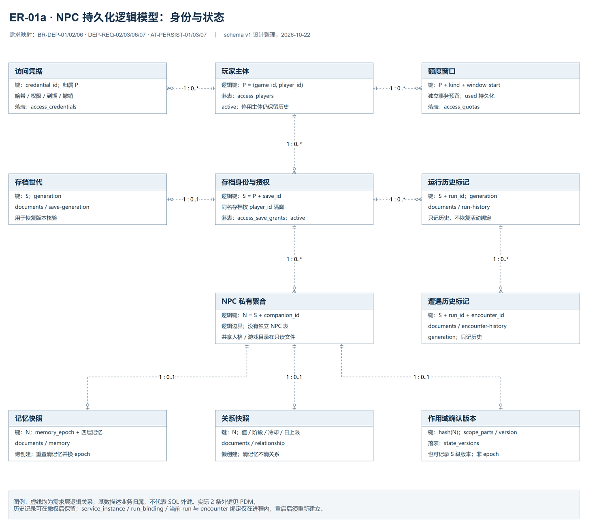
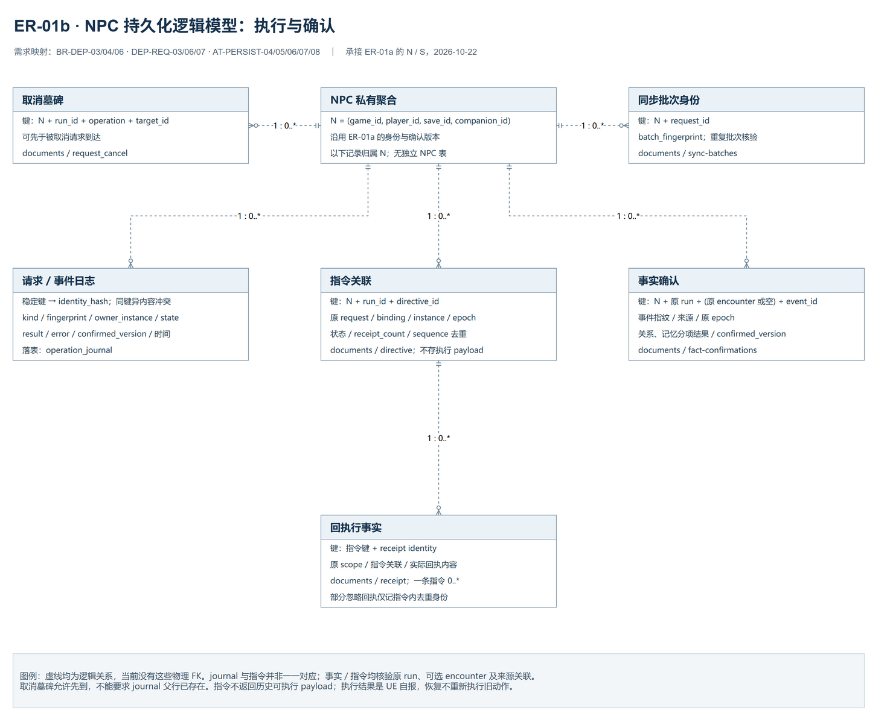

# NPC持久化需求与逻辑模型

> 2026-10-22，`database-design-v1`，对应 `feature/npc-persistence-access` 的schema v1。本文是第四步实现后补齐的需求追踪与模型审查，不追记为编码前已完成的设计。需求含义以原需求及契约为准，表级定义见[PDM说明](02-physical-model.md)与[数据字典](03-data-dictionary.md)，实施状态和实测结果另记验证记录。

## 1. 范围与权威位置

本设计覆盖云端队友NPC的可信玩家/存档授权、记忆与关系、确认版本、持久幂等、指令/回执及真实事实同步；Boss本地推理、UE运行时世界、通用账号门户、音频保存和模型权重不进入本轮业务库。继续使用独立MySQL 8.4应用库和单worker，不因增加SQL存储宣称多worker或UE接入已经完成。

| 依据 | 本页用途 |
| --- | --- |
| [NPC SDD v1.1](../../planning/aesir-agent-sdd-v1.1.md) | 保留原REQ、UC、FR、BR及人格/记忆/关系边界，不重新编号需求 |
| [部署需求与规则](../../guides/deployment.md) | 认证作用域、事务权威、稳定事实、离线及重置屏障的需求来源 |
| [NPC交互与服务演进](../../planning/npc-interaction-evolution.md) | EVO-01正式认证/持久化余项、EVO-03同步子集；其他增量不自动纳入本次 |
| [第四步计划](../../planning/step-04-persistence-access-plan.md) | 工作包、验收定义和本轮边界，任务状态仍由里程碑/Issue维护 |
| [持久化增量契约](../../protocols/npc-persistence-contract-v0.4.md) | 对外字段、错误、提交与恢复语义；本页不另建一份接口协议 |
| [SQL开发与运维指南](../../guides/persistent-development.md) | 初始化、授权、导入、备份/恢复及UE交接操作 |

共享CompanionProfile、游戏能力目录及关系策略沿用YAML定义，不复制为每位玩家的可变记录。原始会话滚动历史仍在进程内，提交后追加、重启不恢复；MemorySnapshot的`short_term`是既有记忆条目层，不能据其字段名推称已保存完整原文会话。诊断JSONL另有既定保留范围，不作为持久确认权威。

当前DDL以 `app/persistence/schema.py`、`auth.py`、`journal.py` 的SQLAlchemy Core metadata为实现基线。ER表达业务身份和关联，PDM表达实际8张表；二者粒度不同，不要求每个逻辑实体对应独立物理表。附图也不将现有UML领域类图重新命名为数据库ER图。

## 2. 需求到数据职责

| 需求/规则 | 逻辑数据及约束 | 当前落点与验收关联 |
| --- | --- | --- |
| REQ-08、FR-044；DEP-REQ-02、BR-DEP-01；C1 | 可信玩家、存档授权、完整NPC作用域；客户端自报ID不构成权限 | `access_players/save_grants/credentials`；所有文档key、日志及查询保留归属；AT-PERSIST-01/02 |
| FR-006～009/012；BR-05；DEP-REQ-03、BR-DEP-02 | 分层记忆、来源与时间、容量/预算；持久数据重启保留 | `memory`文档承载既有MemorySnapshot；不新增并行记忆模型；AT-PERSIST-03/05/09 |
| FR-010、REQ-07；BR-DEP-06；M4 | 新memory_epoch与空记忆一起提交，关系/人格保留，旧代写入不能复活内容 | `memory`文档、请求日志及事实分项确认；AT-PERSIST-03/07 |
| FR-013～016、BR-04；BR-DEP-03 | 玩家对该NPC的关系快照、冷却及日上限；同一事实不重复计分 | `relationship`、`fact-confirmations`；AT-PERSIST-03/06/07 |
| DEP-REQ-03、BR-DEP-02/03；D1/D2/G4/C2 | 稳定请求/事件身份、语义指纹、owner和终态；请求结果与业务一次提交 | `operation_journal`、`request_cancel`、`state_versions`；AT-PERSIST-03/04 |
| FR-045、BR-DEP-03/04；G3/G4 | 原请求产生的统一指令；UE回执保留原关联，重复和乱序不倒退终态 | `directive/receipt`；AT-PERSIST-04/05/06，不新增平行指令信封 |
| DEP-REQ-03/07、BR-DEP-03/04/06；C3/M2/M4 | 原存档世代、run/encounter、稳定事实、分项确认与同步批次 | `save-generation/run-history/encounter-history/fact-confirmations/sync-batches`；AT-PERSIST-06/07 |
| DEP-REQ-02/06、BR-DEP-01；C4预算子集 | 凭据过期/撤销和权限、玩家准入/上游调用额度 | `access_credentials/access_quotas`；AT-PERSIST-02/08/11，额度不是货币费用硬预算 |
| DEP-REQ-06、BR-DEP-02 | 独立库、明确schema版本、受限账号、可恢复备份与归属明确的旧JSON输入 | `schema_versions`及全库恢复集；AT-PERSIST-09/10/11 |
| FR-011/018的原降级目标；DEP-REQ-07、BR-DEP-01/02/04 | 云端持久/认证故障必须如实拒绝，游戏由UE本地基础AI兜底 | SQL故障不切匿名、共享JSON或未确认关系初值；属于部署契约边界，不能把旧本机降级描述当正式数据库故障策略 |

本表只追踪数据职责，不宣称全部原FR、EVO或DEP验收已经通过。尤其UE事实队列、HTTPS、负载、备份调度、多设备合并仍有独立交付边界。

## 3. 身份层级与基数

以下缩写用于key说明；所有元组成员按顺序转换为字符串，UUID使用规范字符串：

| 缩写 | 定义 | 含义 |
| --- | --- | --- |
| `P` | `(game_id, player_id)` | 游戏内可信玩家，不以player UUID单独跨游戏认领 |
| `S` | `(*P, save_id)` | 玩家名下的存档身份；当前没有独立saves物理表 |
| `N` | `(*S, companion_id)` | 完整NPC可变状态作用域，角色共享配置不共享该状态 |
| `R` | `(*N, run_id)` | 某NPC在某次run内的业务归属；run控制历史本身按S保存 |
| `Q` | `(*R, operation, request_id)` | 稳定逻辑请求身份，operation区分chat/event/reset/归档等 |
| `F` | `(*N, origin_run_id, origin_encounter_id或空串, event_id)` | 实时/离线共同事实身份，不能靠新批次ID变成新事实 |
| `D` | `(*R, directive_id)` | 原run内指令身份 |

`service_instance_id/run_binding_id/session_id/memory_epoch`是生命周期、授权或语义校验字段，不加入Q、F、D制造新的同事实执行资格；其值进入对应请求指纹或记录关联。当前活动绑定在服务重启后失效，持久控制历史不会恢复旧绑定。`save_generation`与`memory_epoch`分别表示存档世代和NPC记忆重置世代，二者不能互换。

| 逻辑实体 | 业务身份 | 基数及生命周期 |
| --- | --- | --- |
| 玩家 | P | 一个玩家有0..N存档授权、0..N凭据、0..N额度窗口；每条授权/凭据只归属一个玩家 |
| 存档授权/存档身份 | S | 一个存档身份有0..N NPC聚合、0..N run历史和0..1已登记世代；撤回active不级联删除既有历史 |
| 存档世代 | S，值为generation UUID | 首次登记后当前实现不提供随意换世代接口；所有原run/encounter按该世代核对 |
| run历史 | `(*S, run_id)` | 一个run可有0..N encounter历史，并被0..N NPC操作/事实引用；记录存在不表示当前活跃 |
| encounter历史 | `(*S, run_id, encounter_id)` | 归属一个run；事实的遭遇可选，战斗类事实必须有原遭遇 |
| NPC聚合 | N | 概念归属边界，无同名物理表；每个聚合有0..1持久记忆快照、0..1关系快照和0..1版本记录 |
| 记忆快照 | N | 以一个memory_epoch和四层列表组成；0..N MemoryEntry/TopicImpression作为聚合内值对象，不各自建表 |
| 关系快照 | N | 保留关系值、阶段、UTC日、正向日额度、近期事件和各类最近计分时间；未建立时读配置初值 |
| 确认版本 | N，另有S层控制版本 | 一次有变更/mutation的UoW递增其scope版本；各事实/操作可引用同一已确认版本号 |
| 请求/事件日志 | Q或F，另加kind | 一个NPC聚合有0..N操作日志；一个请求可产生0..N指令。并非所有控制请求均进入该journal |
| 指令 | D | 属于一个NPC/run，并关联原请求；有0..N实际回执记录；回执必须先有合法原指令 |
| 回执行事实 | `(*D, receipt_identity)` | sequence或语义指纹标识回执；终态后新accepted可仅登记去重身份而不新增receipt文档 |
| 取消墓碑 | Q | 可以在目标请求到达前存在，故不依赖已有journal父行；不自动清除后允许旧请求重做 |
| 事实确认 | F | 属于一个NPC、一个原run和至多一个原encounter；分别确认关系和记忆结果，一次事实只应用一次 |
| 同步批次 | `(*N, request_id)` | 一批包含1..N事实，单事实可被不同批次重传；逻辑上是多对多提交关系，当前不存批次成员关联表 |
| 凭据 | credential UUID | 属于一个玩家；权限绑定到凭据，存档授权从玩家当前授权集合读取，不在token中冻结一份 |
| 额度窗口 | `(*P, kind, window_start)` | 按game/player累计，不能靠切NPC/session绕过；独立事务预留，不随业务回滚退款 |

表中1及0..N描述业务归属，不表示当前数据库拥有全部外键。物理约束仅有玩家→存档授权、玩家→凭据两条复合外键；其余由业务校验、唯一键、CAS与事务维护。概念归属不保证直接用SQL写入任意JSON也能满足不变量。

## 4. ER图与物理映射

ER源文件包含两页；图中的虚线表示逻辑归属/关联，不表达数据库外键。状态页突出主体、存档和聚合，操作页突出稳定身份及反馈闭环；完整字段以本页与数据字典为准。

| 图页 | 可编辑源 | 预览 |
| --- | --- | --- |
| DB-ER-01 主体、存档与NPC状态 | [draw.io源，两页](src/01-npc-persistence-er.drawio) | [PNG](png/01a-npc-identity-state.drawio.png) |
| DB-ER-02 操作、事实与回执 | 同上，第2页 | [PNG](png/01b-npc-operations-feedback.drawio.png) |
| DB-PDM-01 当前schema v1物理表 | [draw.io源](src/02-npc-persistence-pdm.drawio) | [PNG](png/02-npc-persistence-pdm.drawio.png) |

| 实际物理表 | 逻辑职责 | 与其他表的物理关系 |
| --- | --- | --- |
| `schema_versions` | 当前结构版本登记，`id=1`记录schema版本 | 无外键；版本标记不是已具备通用增量迁移器的证明 |
| `access_players` | 玩家注册和启停 | 被下述两张表复合外键引用 |
| `access_save_grants` | 具体存档授权和撤回 | `(game_id,player_id)` → `access_players` |
| `access_credentials` | 不透明凭据的哈希、权限、过期/撤销 | `(game_id,player_id)` → `access_players` |
| `access_quotas` | 玩家准入/上游调用窗口预留 | 无外键，当前由应用验证玩家并预留 |
| `documents` | 10类带namespace的业务聚合/确认记录 | 无外键；namespace+key_hash为复合主键 |
| `state_versions` | NPC或存档scope的事务确认序号 | 无外键；scope_hash主键并保留原scope校验 |
| `operation_journal` | 稳定请求/事件占位、终态、结果与原实例 | 无外键；identity_hash主键并核对原key/指纹 |

## 5. documents命名空间与逻辑键

这10种namespace来自当前读写路径，均与schema v1共享一个documents物理表。`key_hash=SHA256(按固定顺序紧凑JSON编码的key_parts)`，`namespace`在复合主键中单独区分类型；读取还核对原key_parts。哈希只是索引身份，不代表认证，也不允许混用排序不同的元组。每个payload必须是JSON对象。

| namespace | 完整key_parts | scope_parts | 当前payload及关联 |
| --- | --- | --- | --- |
| `memory` | N | N | `memory_epoch`、`short_term/summaries/archive/impressions`；MemoryEntry含entry_id/content/importance/source/game_time/real_time/tags，印象按TopicImpression保存；与epoch一起替换 |
| `relationship` | N | N | `value/stage/day/daily_net/recent_events/last_event_at`；stage加载重算，recent_events为解释性近期记录，冷却依据独立last_event_at |
| `save-generation` | S | S | `generation`；无记录时独立短事务首次登记，不构成任意分支合并或手动覆盖世代的接口 |
| `run-history` | `(*S, run_id)` | S | `run_id/generation`；只证明原run曾绑定此存档世代，不保存当前活动绑定/会话恢复状态 |
| `encounter-history` | `(*S, run_id, encounter_id)` | S | `run_id/encounter_id/generation`；只证明原遭遇控制历史；begin时登记，不表示遭遇当前未结束 |
| `directive` | D | N | `binding_id/service_instance_id/session_id/encounter_id/request_id/ability_id/memory_epoch/fingerprint/expires_at/state/last_result/sequence/receipt_count/sequences/unsequenced`；保留原关联及去重索引，不保存可执行技能payload供恢复 |
| `receipt` | `(*D, receipt_identity)` | N | 原严格回执字段加`scope`，后者含完整NPC、run、epoch、service_instance、binding、session、encounter；receipt_identity为`s:<sequence>`或`f:<fingerprint>` |
| `request_cancel` | Q | N | `origin_service_instance_id/origin_run_binding_id/origin_memory_epoch`；持久先到取消屏障，不要求目标journal行存在 |
| `fact-confirmations` | F | N | `event_id/origin_run_id/origin_encounter_id/origin_memory_epoch/source/fingerprint/event/result/confirmed_version`；event保存原事实，result仅relationship_status/relationship_delta/memory_status；confirmed_version最终事务补齐 |
| `sync-batches` | `(*N, request_id)` | N | 只有完整批次`fingerprint`，用于同ID异载荷冲突；不保存另一份事实内容、成员清单或可供重播的动作 |

`documents.version`是单文档CAS版本；`state_versions.version`是对应事务scope的确认序号；`confirmed_version`是某次已确认应用结果引用的序号。它们均不能替代epoch或generation。初次独立登记save-generation直接插入文档v1，不递增state_versions；run/encounter历史通过S层UoW可产生S层版本。对外NPC状态版本仍按N查询，无记录读0。

`directive.sequences/unsequenced`记录已见回执身份，其中一些可能没有对应receipt文档：终态后的新accepted被登记后忽略，因此不能按receipt行数推导收到身份总数。同步批次也不存成员关系，不能从sync-batches反查一批事实清单；该能力若成为需求，应另设计持久关联。

## 6. 稳定身份与事务边界

operation_journal的`identity_hash=SHA256((kind,*key_parts)的固定JSON编码)`。请求使用Q；事件使用F中的当前run/encounter。请求指纹包含完整语义载荷，去掉重试时变化的capture_age_ms/request_age_ms；事实确认指纹针对原event，另核对origin_memory_epoch。更换binding/epoch不是给原逻辑ID重新执行的许可，同ID改内容明确冲突。

1. 请求先用短事务claim一行`running`，保存owner service instance；随后释放连接，LLM生成不占长事务。
2. 业务阶段在请求本地暂存文档，最终短事务以文档CAS提交记忆/关系/epoch、指令/回执、事实确认、scope版本和操作结果；同一UoW确认成功后才放行会话FIFO。
3. 凭据及存档授权在提交边界再次复核。上游调用额度在独立短事务预留，已发调用不能通过取消/回滚归还。
4. 事务失败不保留部分业务状态；提交是否成功无法判定时保守UNKNOWN。重启后旧running不重新抢占，旧complete只供历史确认，不刷新动作有效期。
5. 清记忆替换epoch和四层记忆，不清关系/人格或删除幂等历史。旧epoch事实的memory分项跳过，relationship分项按共同稳定身份独立确认；历史回执只归档原关联，不再写旧记忆。

操作结果和事实event/details可能包含业务文本，数据库不是仅存匿名哈希的系统；清记忆也不扩大为删除所有历史操作、事实、回执和日志。更广的数据删除需求须另明确授权范围及去重屏障保留方式。

本轮数据库不自动TTL删除逻辑身份。当前没有外键级联清理与统一归档任务，不能直接删除旧journal/fact/墓碑后宣称“历史请求仍不重复执行”。需要清理时先定义保留期限、UNKNOWN处置及长期去重摘要，再随版本化迁移交付。

## 7. JSON聚合边界的审查结论

| 数据 | 当前采用JSON的理由 | 当前代价与后续触发条件 |
| --- | --- | --- |
| 记忆/关系快照 | 按完整NPC读取/提交，已有严格Pydantic模型、容量与预算；与epoch/CAS一并更新可保持聚合一致 | 每次改动重写快照；条目级检索/纠错/分页或热点写入成为实际需求后，评估独立entry表和必要索引，不预设向量库 |
| save/run/encounter历史 | 当前只按完整key核验原归属，结构小、无跨存档搜索需求 | 当前无物理FK和结构化世代索引；来源审计/批量查询或并发控制扩展后，优先拆为明确身份列的表 |
| 指令/回执/事实确认/取消墓碑 | 已用稳定唯一键、原key校验、业务UoW实现点查与去重，可复用一次提交边界 | 生命周期长、数量增长且恢复/审计重要；优先候选独立表，使原run/encounter、状态、时刻和稳定ID可索引，关系约束可检查 |
| sync-batches | 当前仅需按NPC+批次ID校验指纹，不需内容回放 | 如果要求批次成员查询、逐项恢复/游标补拉，应增加batch及batch_fact关联模型；不能以现有fingerprint推称已支持 |
| 认证/额度/操作日志 | 当前已独立关系表，服务按稳定列鉴权、claim与额度行锁更新 | 权限目前逗号分隔，不提供RBAC/权限任意配置；独立权限表应由账号产品需求驱动。quota暂无FK/清理，journal暂无scope/时间二级索引 |

审查结论是：当前8表设计可作为受控单worker的第一版持久化基线，JSON快照适合有界NPC聚合；通用documents不适合作为后续所有业务无限扩张的默认答案。本次补齐设计材料不默默把已验证实现改成另一套表，也不把应用约束写成数据库保证。

优先级先后为：保住现有身份/事务语义及恢复证据；按实际查询和容量样本补索引或拆高增长账本；最后再按需求拆快照。新增表/索引需同步metadata、schema版本、保留SQL、PDM/字典及真实MySQL验证。重构时同一事实的新旧存储不能分开提交而重复确认。

## 8. 当前限制与后续设计门槛

| 当前限制 | 后续进入条件与需补设计 |
| --- | --- |
| 通用文档无业务FK/JSON字段级约束 | 拆表前冻结稳定自然键、原关联、CAS与UNIQUE约束；逐批回填校验并保留来源映射，不能仅复制payload后切换 |
| 作用域/时间检索索引不足 | `list_documents`当前按namespace读再在进程筛scope，增长后扫描成本增加；用实际访问计划和数据量确定结构化scope列/组合索引，不凭8表数量宣称容量通过 |
| 结构门禁与业务审计的边界 | 运行时和离线检查现共享metadata规则，dev漂移已备份后修复；结构通过仍不证明JSON业务字段、授权目录、数据保留或容量通过，后续约束与迁移继续单独设计 |
| 没有活动run/会话持久化和多worker协调 | 多worker前重新设计跨进程绑定、排队、取消、最终授权与占位一致性；CAS不能替代这些运行态协议 |
| 未定义长期账本清理、分页恢复或全量游标 | 发布前核定保留/容量；任何清理先证明不释放旧事实/UNKNOWN执行资格，按契约增量实现游标而非宣称现有端点已有 |
| 仅受限CLI签发账号和存档授权 | 用户系统/联机身份接入后再设计外部主体映射、注册/密码或RBAC；不在当前库添加无来源用户信息 |
| 备份只到恢复点 | 恢复默认撤销所有token；恢复点后的撤销/reset需显式收敛，不能推断未来事实。调度/异地副本/RPO/RTO另验 |

首次设计整理确认逻辑模型与实现的对应关系，当时未执行既有库变更。后续第四步已备份后修复dev的v1可空性漂移，并接入共享结构门禁，见[本轮验证](../../logs/verification-records.md#schema-gate-20261022)；UE数据切换继续待验。实际建表SQL、schema差异及执行前置条件统一见[PDM说明](02-physical-model.md)和[目录索引](README.md)；检验结果由验证记录保留，设计目标不替代验收证据。
