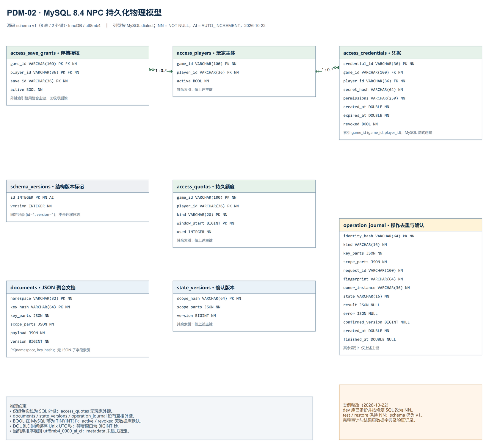

# NPC持久化物理模型

> 2026-10-22，`database-design-v1`，对应 `schema_version=1`。本页以当前SQLAlchemy Core声明为物理规范，并单列既有验证库的实际差异。需求与逻辑实体见[需求与逻辑模型](01-requirements-and-logical-model.md)，逐字段语义见[数据字典](03-data-dictionary.md)，可执行DDL见[SQL说明](sql/README.md)。这是第四步实现后的设计补齐与核对，不倒写成实现前已完成评审。

## 1. PDM与规范边界

[可编辑draw.io源文件](src/02-npc-persistence-pdm.drawio)由本地draw.io MCP维护，PNG由draw.io Desktop导出。PDM展示实际代码声明的8张表；ER中的存档、NPC状态、事实、指令、回执等逻辑实体，通过 `documents.namespace` 与JSON载荷映射，不等于已有同名独立物理表。

| 项目 | v1规范与当前边界 |
| --- | --- |
| 声明来源 | `app/persistence/schema.py`、`auth.py`、`journal.py`；业务写入在 `database.py`、`uow.py`、`directives.py`、`sync.py` |
| 引擎与编码 | 全8表使用InnoDB、utf8mb4；源码没有显式指定collation |
| 样本环境 | 独立MySQL 8.4.13验证实例；首次审查发现dev漂移，后续已备份并修复，三个项目库只读审计均通过 |
| 实际collation | 验证库全8表继承 `utf8mb4_0900_ai_ci`；新库必须预先核对数据库默认值，不假定任意环境相同 |
| 时间表示 | `created_at/expires_at/finished_at` 为UTC Unix秒的DOUBLE；额度窗口起点为BIGINT整数秒，未使用MySQL TIMESTAMP |
| 默认值 | `active=True`、`revoked=False` 是SQLAlchemy客户端默认值，不是数据库 `DEFAULT`；直接SQL写入必须显式提供 |
| 约束范围 | 8个主键、2条物理外键；无额外UNIQUE/CHECK声明，无自动级联删除策略 |
| 运行范围 | 单worker、短事务；数据库已存在不代表运行时binding、队列和取消已具备多worker一致性 |

时间使用DOUBLE是已验证的物理精度约束，不能替换成单精度FLOAT。应用 `check_schema()` 与离线MySQL审计共用结构检查，对照metadata核对字段、类型、可空性、默认值、主外键和索引等声明；具体覆盖与部署约束见第8节。

## 2. 八表、主键与物理关系

| 表 | 主键，按声明顺序 | 物理外键与作用 |
| --- | --- | --- |
| `schema_versions` | `id` | 无；应用约定使用 `id=1` 的单条版本记录，数据库本身没有 `id=1` 的CHECK |
| `access_players` | `game_id, player_id` | 无；可信玩家登记与停用状态 |
| `access_save_grants` | `game_id, player_id, save_id` | `(game_id, player_id)` → `access_players`；存档授权，不是存档内容表 |
| `access_credentials` | `credential_id` | `(game_id, player_id)` → `access_players`；凭据哈希、权限、期限、撤销状态 |
| `access_quotas` | `game_id, player_id, kind, window_start` | 无；玩家维度的请求/上游调用预留窗口 |
| `documents` | `namespace, key_hash` | 无；多种业务聚合的JSON文档与CAS版本 |
| `state_versions` | `scope_hash` | 无；作用域已确认版本 |
| `operation_journal` | `identity_hash` | 无；稳定请求/事件身份、owner、状态与历史确认 |

PDM中的实线只表示上述两条真实外键。MySQL自动生成的样本约束名为 `access_save_grants_ibfk_1`、`access_credentials_ibfk_1`，不将这些环境生成名称作为跨环境业务标识。外键未声明ON DELETE/ON UPDATE级联，删除玩家前须单独处理引用，不把删除玩家当作全作用域数据清理。

`access_quotas` 与玩家的关系由鉴权和准入路径保证，当前没有物理外键。`documents`、`state_versions`、`operation_journal` 之间也没有外键；它们依靠完整原始key/scope校验、事务边界及协议保持一致，图上的逻辑联系不能误读为数据库自动保证。

## 3. 逻辑键、哈希与大小写

完整NPC键为 `(game_id, player_id, save_id, companion_id)`；存档控制历史使用前三段的save键。UUID在应用中规范为连字符小写字符串；game_id与companion_id保留输入大小写。run、request、event、directive等维度按各命名空间的契约追加，不把service_instance、binding、epoch擅自加入稳定身份以绕开去重。

`parts_hash()` 对规范字符串元组的紧凑UTF-8 JSON计算SHA-256。`documents.key_hash` 是文档完整key的哈希，`state_versions.scope_hash` 是作用域哈希，journal的 `identity_hash` 还把 `kind` 作为前缀；相同NPC在不同表中的哈希不因此相等。原 `key_parts/scope_parts` 必须保留并在读取时核对，哈希既不替代作用域授权，也不是可连接到另表主键的天然外键。

`documents.version` 是该文档的CAS版本；`state_versions.version` 是该作用域的提交确认序号；`operation_journal.confirmed_version` 引用当次完成的确认版本。三者有不同语义，不能取最大文档版本冒充NPC确认版本。NPC状态通常使用四段作用域，存档控制历史也可能使用三段作用域；字典必须按实际key长度解释，不能强行将所有 `scope_parts` 都当成NPC键。

当前 `utf8mb4_0900_ai_ci` 的字符串比较不区分大小写。规范UUID和小写十六进制哈希受控，但 `safe_segment()` 允许大小写game_id/companion_id，哈希计算又区分大小写，因此直接授权表的字符串键与文档键的比较语义存在差异。当前按单一服务端配置game目录运行，不得注册仅大小写不同的游戏作为不同租户。正式扩展前应明确统一规范化策略，或在显式迁移中给标识列采用经验证的区分大小写collation；迁移前必须排查冲突并同步应用校验、数据字典与测试，本次没有悄悄修改collation。

## 4. 索引与真实访问路径

| 访问 | 现有索引/执行方式 | 设计含义 |
| --- | --- | --- |
| 读取或CAS单个JSON文档 | `documents.PRIMARY(namespace, key_hash)`；更新同时比较version | 主键定位后由应用核对原key；version不另建索引 |
| 列出某命名空间的作用域文档 | SQL仅按namespace取行，Python按 `scope_parts` 前缀过滤并排序 | 命中主键最左前缀，但没有scope索引、分页或数据库侧JSON筛选；随整个namespace规模增长 |
| 读取/锁定确认版本 | `state_versions.PRIMARY(scope_hash)`；提交时 `FOR UPDATE` | 行锁只保护最终短事务，不覆盖LLM生成阶段 |
| 请求/事件claim、完成与恢复 | `operation_journal.PRIMARY(identity_hash)` | request_id不是全局唯一键；恢复必须结合原run、operation及完整NPC重建身份 |
| Bearer查询、撤销 | `access_credentials.PRIMARY(credential_id)` | 从token解析credential_id，再恒定时间比较SHA-256；secret_hash没有唯一索引，也不是查询入口 |
| 校验玩家、列出有效存档授权 | `access_players.PRIMARY(game_id, player_id)` 与 `access_save_grants.PRIMARY(game_id, player_id, save_id)` | 存档授权利用复合主键最左前缀；active是后续过滤条件 |
| 预留额度 | `access_quotas.PRIMARY(game_id, player_id, kind, window_start)`；行锁与条件增量 | 请求和上游窗口独立，按game/player累计，不按NPC或session分散额度 |
| 凭据外键维护 | MySQL为 `access_credentials` 自动创建非唯一 `game_id(game_id, player_id)` 索引 | 这是物理外键所需索引；`access_save_grants` 已由主键前缀满足，无重复索引 |

目前没有按scope、state、created_at、expires_at、event_type或JSON字段建立的二级索引，也没有全文或向量索引。恢复入口是稳定ID点查，不提供跨玩家的历史搜索。运维统计、过期清理和按玩家导出不能默认具有点查性能。

## 5. 写入、事务与恢复

1. 先用独立短事务写journal的running占位，绑定原身份、指纹和owner；同身份改内容拒绝，其他进程实例不能抢占旧running。
2. 生成期间通过短连接读取，业务变化暂存在请求UoW。LLM等待不持有数据库连接或行锁；记忆/关系不把未提交状态泄漏到全局缓存。
3. 到最终提交边界，再校验runtime、NPC、取消与可信授权；同一SQL事务完成文档CAS、作用域确认版本和journal结果。新文档version从1开始，已存在文档只按预期version更新；冲突返回 `STATE_VERSION_CONFLICT`。
4. 事务回滚不追加会话历史；提交后才执行本地finalization及尽力诊断。COMMIT确认丢失或已提交后的收尾失败保守返回UNKNOWN，不能自动换request_id再执行。
5. 服务重启生成新service_instance并要求重新发现/bind。旧complete是历史确认；旧running按unknown核对，不自动重做。只有安全的历史归档确认有专门允许的跨实例回放语义，不恢复旧动作的有效期。

请求准入和上游额度使用独立短事务，已预留次数不随业务回滚、取消或重启退回。同步批次的事实分项、版本与批次确认同事务提交；历史回执只归档已存在的原指令关联。诊断JSONL不是SQL确认账本，会话原文不因增加数据库而自动长期入库。业务与恢复边界继续以[持久化契约](../../protocols/npc-persistence-contract-v0.4.md)为准。

## 6. JSON聚合的保留理由与拆表条件

v1把变动频繁的NPC记忆快照和受协议控制的确认/回执聚合保存在JSON，便于沿用已验证模型及整聚合CAS。字段长度、枚举、角色与游戏目录等多数业务规则由Pydantic和服务层控制；数据库JSON类型只保证可存储的JSON，不自动证明载荷满足业务schema。此方案适合当前单worker、按完整逻辑键访问的阶段，不能代替正式容量结论。

| 维度 | 当前可接受条件 | 触发后续物理设计的信号 |
| --- | --- | --- |
| 读取范围 | 大多数请求按完整键点查 | namespace列举读取大量不相关玩家数据，或需要稳定分页/按scope筛选；先测量扫描行数、响应体与p95 |
| 数据增长 | 单NPC聚合与事务体积保持在实测预算内 | 收据/事实历史持续增长，整JSON更新、网络传输或锁等待超出已定义预算；不靠删除身份恢复容量 |
| 查询能力 | 协议只需ID恢复和权威快照 | 需要按时间、状态、玩家、遭遇查询或受控删除；应显式提取scope/状态/时间列并设计索引 |
| 并发写入 | 单worker与NPC队列控制同聚合写入 | CAS冲突和聚合重写成为瓶颈；可拆分高频事实/回执，但不能移除原子提交与稳定唯一身份 |
| 数据治理 | 应用能够完整验证、导出、备份和恢复 | 需要数据库强约束、独立保留周期或可证明的主体级清理；应评估独立业务表与明确FK |

后续候选是把run/encounter历史、事实确认、directive和receipt等稳定记录拆成独立表，保留memory/relationship按NPC聚合，并提取真实scope列供查询。候选不等于当前实现；每次拆分需先设计复合唯一键、FK与作用域匹配约束，保持实时/离线共用事实身份，安排历史回填和迁移期间读写策略。单纯给JSON里几个字段添加名称，不能声称已经关系化。

本轮容器640MiB、0.75CPU及连接池5只是验证资源配置，不代表支持的在线玩家数、写入吞吐或journal保留年限。第六步应以目标负载测量表行数、JSON大小分布、扫描行数、池等待、锁等待、事务耗时与备份恢复时间，再决定拆表、索引和资源调整。

## 7. 重置、撤销与清理边界

| 操作 | 当前行为/约束 |
| --- | --- |
| 清记忆 | 生成新memory_epoch并清理该NPC记忆；不顺带删除关系、事实去重、journal或回执，旧epoch记忆分项不能恢复 |
| 撤销凭据、撤回存档、停用玩家 | 更新授权状态；不是物理级联删除，也不撤销已经提交的事实 |
| 进程内clear | 仅清理易失重放时钟/缓存；持久journal身份继续保留 |
| journal/事实/取消墓碑/回执清理 | 当前没有自动TTL或通用purge；不能通过删除UNKNOWN或去重身份使旧请求重新获得执行资格 |
| 额度清理 | 当前没有自动窗口清理器；后续只可在明确窗口与审计保留策略下清理旧窗口，不能退款当前预留 |
| 主体删除/隐私清理 | 当前没有全套产品化删除工具；正式引入前需定义可保留的最小防重屏障、备份失效和恢复后的再次清理，不只删memory文档 |

备份须同时覆盖业务状态、epoch、确认版本、身份屏障、授权/撤销和额度。恢复默认撤销恢复的所有credentials，再显式核对授权重新签发；较旧备份之后的reset/撤销不会自动重现，启用恢复目标前须收敛。操作见[持久化开发指南](../../guides/persistent-development.md)。

## 8. 实现核对与后续变更

PDM、字典和 `001-initial-schema.sql` 以源码v1声明为规范，不能用一个schema版本号掩盖实际列定义差异。首次只读核对发现dev库的 `access_credentials.expires_at` 为 `DOUBLE NULL`，源码与DDL要求 `DOUBLE NOT NULL`；test/restore当时已符合规范。后续推进已先备份dev，再通过版本、列型及NULL=0前置检查后执行保留的v1修复SQL；三个项目库现均为 `DOUBLE NOT NULL`，只读结构审计均通过，版本标记仍为1。过程与结果见[本轮验证记录](../../logs/verification-records.md#schema-gate-20261022)。

`check_schema()` 与设计审计命令现复用 `app/persistence/validation.py`，不再让运行时只做DOUBLE列型检查。共享检查精确核对8表集合、列名/顺序、编译后的物理类型及长度、nullability、数据库默认、MySQL自增、非预期生成列、主键顺序、外键列及更新/删除行为、二级索引列/唯一性/重复数量、非预期CHECK，以及MySQL的InnoDB和utf8mb4要求；版本表必须仅有 `(1, SCHEMA_VERSION)` 一行。SQL启动及首次取连接先校验，通过后缓存连接，不在每次请求重复反射；漂移拒绝为 `DATABASE_SCHEMA_MISMATCH`，不向HTTP暴露内部差异。未在metadata固定的collation不会强制等于样本 `utf8mb4_0900_ai_ci`；可用不等于大小写策略已经完成正式验收。检查只读，不审计业务行内容或数据库权限，不修复库，也不替代JSON业务约束与容量验证。v1漂移修复与未来真正的版本迁移分别管理，步骤见[SQL说明](sql/README.md)。
