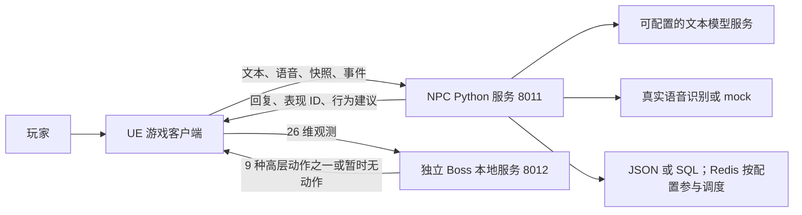

# Aesir AI Service 接手导览：结构、接口、功能与进度

**面向读者：**刚接手项目、暂时不想从源码入手的人。
**整理日期：**2026-11-12。**代码基线：**`develop-dyh@3e4bcf1`。
**使用方法：**先读第 1～5 节建立全貌，再读第 6～9 节理解接口和实际调用，最后按第 10～15 节判断进度与接手顺序。

本文依据本地代码、已注册接口、已有验证记录和本次会话确认整理。没有读取私人密钥，也未查询 GitHub Issue 的实时状态。它是一份接手说明，不另建任务看板；后续日常任务仍以项目 Issues 为准。

## 1. 这个项目到底做什么

这是游戏 **AesirWarden 的 Python 配套服务**，不是完整游戏工程。它主要承接两条工作线：

1. **队友 NPC 服务：**让 Alice、Bruno 等角色理解玩家输入、生成回复、读取记忆、更新关系、提出高层行为建议，并记录游戏端反馈。
2. **Boss 强化学习：**训练或加载 Boss 高层动作策略，在独立本地进程中选择动作。

游戏本体在另一个 UE 仓库。角色怎么移动、技能能不能放、动画怎么播、伤害怎么计算，最终由 **Unreal Engine（UE）** 决定。Python 返回“建议施放某技能”，不等于游戏已经施放，也不等于命中。

用两个例子区分：

| 玩家看到的事情 | Python 做什么 | UE 做什么 |
| --- | --- | --- |
| 对 Alice 说“你好” | 选择角色、读取记忆和关系，生成文本及表情/手势 ID | 接收输入，展示字幕，播放匹配的表现 |
| 对 Alice 说“原地等我” | 理解意图，在允许范围内产生 wait 指令和有效期 | 判断指令是否仍有效，让角色实际等待，再发送回执 |
| 与 Boss 战斗 | 本地策略服务根据一组观测值返回高层动作 | 提供观测、核对动作合法性、执行战斗、结算结果 |

**你接手的核心不是“把一个大模型连起来”，而是维护一条有身份、有状态、有时效、有回执的游戏 AI 调用链。**

## 2. 先认识两个服务、三类外部组件



| 部分 | 当前入口 | 目标运行位置 | 当前理解方式 |
| --- | --- | --- | --- |
| NPC 服务 | `app.main:app` | 正式目标为远程服务器，开发可本机运行 | 玩家访问的是这个 HTTP 服务 |
| Boss 推理服务 | `rl.boss.inference_app` | 玩家电脑本地 | 与 NPC 分开启动，不能用 8011 代替 8012 |
| LLM | NPC 内部客户端按配置调用 | 外部供应商或另行部署的兼容服务 | 通常不是本仓库训练的模型 |
| ASR | NPC 服务内部选择识别后端 | 可在服务器自部署 faster-whisper | UE 通过 NPC HTTP 上传音频，不必直接接语音供应商 |
| MySQL / Redis | 按存储和调度配置使用 | 独立基础设施 | 不负责生成台词，也不是游戏技能执行器 |

NPC 包 `app/` 不依赖 Boss 包 `rl/`。安装 Boss 的 Torch、Gymnasium、SB3 不应成为启动纯文本 NPC 服务的前提。

## 3. 怎样读“已实现”和“待实现”

项目里最容易混淆的是“代码有了”与“玩家已经能用”。本文使用以下口径：

| 标记 | 意思 | 不能据此推断什么 |
| --- | --- | --- |
| 已实现 | 仓库中有对应模块或接口 | 不代表当前环境已配置或真实供应商可用 |
| 已有受控验证 | 在指定测试、mock、隔离数据库或某次真实样例中验证过 | 不自动代表 UE、生产部署和全部边界都通过 |
| 待联调／待验 | 代码可能已有，缺跨端、真实环境或正式证据 | 不应直接安排别人重写已有功能 |
| 待实现／后置 | 尚缺该范围的正式实现，或明确安排后续 | 不能因为规划文档提到就当作已交付 |
| 暂停 | 用户明确要求先不做 | 本轮 Boss 新候选训练属于这一类 |

例如：SQL 服务端能力已有真实 MySQL 的历史受控证据，但正式数据切换和 UE 离线队列仍待验。这两个结论可以同时成立。

## 4. 项目目录地图：先知道去哪里找

```text
aesir-ai-service/
├─ README.md                   总入口：启动、端口、主要文档
├─ app/                        NPC 服务
│  ├─ main.py                  应用入口、身份/旧协议门禁、异常处理
│  ├─ config.py                配置名称、默认值、组合限制
│  ├─ api/                     HTTP 接口；v1/scoped.py 是新版业务入口
│  ├─ schemas/                 请求与响应的结构定义
│  ├─ services/                对话、记忆、关系、意图、语音等业务能力
│  ├─ scoped/                  玩家/存档隔离、会话绑定、时效、排队与去重
│  └─ persistence/             SQL、凭据、事务、恢复、同步及结构校验
├─ rl/boss/                    Boss 契约、模拟器、奖励、策略、推理和评估
├─ scripts/                    启动、检查、数据运维和交接工具
│  └─ rl/boss/                 Boss 清点、训练、评估、服务启动命令
├─ data/                       配置资产、样例，以及本机运行数据
│  ├─ games/                   游戏能力与允许的指令目录
│  ├─ personas/                Alice / Bruno 等人格包
│  ├─ policy/                  风格、战术、自主行为等策略配置
│  ├─ lore/                    可查证的游戏设定资料
│  ├─ golden/                  规范请求/响应样例，不是真实玩家记录
│  └─ runtime/                 本机诊断、信号、报告等，通常不提交
├─ models/                     本机模型材料，被 Git 忽略
├─ tests/                      自动化测试
├─ docs/                       指南、协议、计划、设计与历史证据
├─ deploy/                     systemd / Nginx / 环境模板
└─ requirements*.txt            按用途划分的依赖清单
```

### 不读代码也能处理哪些事情

| 想了解或调整什么 | 先看哪里 | 注意点 |
| --- | --- | --- |
| Alice 与 Bruno 的性格区别 | `data/personas/aesir/<角色>/` | 人设、示例、表现和能力是不同文件 |
| 角色允许哪些技能和行为 | `abilities.yaml`、`data/games/aesir/` | Python 声明还要与 UE 真正实现逐项对应 |
| 说话风格、自主行为频率 | `data/policy/` | 配置存在不代表支持全系统热更新，修改后按模块生命周期重启验证 |
| 某个接口长什么样 | 本机 `/docs`、`data/golden/` | golden 中的 ID 是样例，不能原样作为当前会话使用 |
| 为什么某事还没验收 | `docs/planning/todo.md` | 区分代码缺口、跨仓依赖与证据缺口 |
| 曾经验证过什么 | `docs/logs/verification-records.md` | 看日期、提交和环境，不能只看总通过数 |

### 依赖文件怎么选

| 文件 | 用途 |
| --- | --- |
| `requirements.txt` | NPC 核心服务 |
| `requirements-dev.txt` | 开发测试，包含核心依赖 |
| `requirements-ml.txt` | 真实语音识别的可选依赖 |
| `requirements-rl.txt` | Boss 训练等 RL 工作 |
| `requirements-boss-inference.txt` | 独立 Boss HTTP 推理所需依赖清单 |
| `requirements-sql-linux-py312.lock` | 既有 Linux Python 3.12 验证环境的约束文件，不是所有平台通用安装包 |

`.venv/` 是本机解释器和依赖，`.env` 是私有配置，`.git/` 是版本历史。它们与业务源码不是一回事；不要复制他人的 `.env` 充当正式配置。

## 5. 功能是怎样协作实现的

这一节只解释职责，不要求阅读函数。

### 5.1 一轮普通聊天

1. UE 提交玩家文本和当前角色、存档、会话标识。
2. 服务先检查身份、存档权限、绑定、记忆代次和请求时效。
3. 对同一角色/会话排队，避免后一句先读到旧历史。
4. 载入该角色人格包，读取当前关系、近期对话和可用记忆。
5. 按配置使用 mock 或 LLM 生成回复，并检查表现 ID、风格等约束。
6. 生成失败时按既有降级机制返回 fallback；写入前还要复核取消、绑定和时效。
7. 提交允许保留的记忆、关系与信号，返回台词、表现 ID、来源和关联信息。

主要模块是 `services/companion`、`services/memory`、`services/relationship`、`services/llm`，外围由 `scoped` 和 `persistence` 保护。

`source=mock` 表示模拟回复；`llm` 表示真实生成路径；`fallback` 表示降级。看到一句自然的回复，不能仅凭内容认定真实大模型成功。

### 5.2 记忆与关系不是同一个东西

| 机制 | 白话解释 | 已有实现 |
| --- | --- | --- |
| 会话历史 | 最近几轮对话，保持上下文 | 会话窗口、按角色/会话隔离 |
| 记忆短期层 | 暂存近期条目 | 条目容量和持久化处理 |
| 经历摘要 | 共同经历的压缩记录 | 聚合摘要与检索 |
| 长期档案 | 事实、承诺、重要经历 | 条目来源、重要度、淘汰和纠错标记 |
| 模糊印象 | 经常谈什么、印象多深 | 主题频率、衰减、重要话题加成和检索 |
| 关系 | 角色对玩家的关系数值与阶段 | 事件冷却、每日上限、阶段展示、回复影响 |

并非把全部历史原文无限塞给模型。检索有条目和上下文预算。纠错也不等于任意删除历史：旧事实可留痕，但被纠正的条目应退出正常检索。

**清记忆不等于清关系或清日志。** 默认对话信号仍可能包含完整输入/回复；不能把新诊断日志只存元数据，理解成整个项目都不保留原文。

### 5.3 一条行为指令

例子：“Alice，原地等我。”

`文本 + 世界快照 → 意图/规则判断 → 能力与场景筛选 → directive → UE 复核 → 实际执行 → 回执`

`agent/step` 是主要高层入口。带文本时处理玩家意图；不带文本时可以处理心跳/自主行为，纯心跳不应每次调用 LLM。当前主入口只返回 `action=none` 或 `action=directive`。

directive 可理解为一张“建议任务单”，有角色、领域、动作、载荷、原因与有效期。它不会绕过 UE 的距离、冷却、资源、目标和动作锁检查。

“等 Boss 晕了再放技能”涉及未来条件监听。目前有即时条件判断，但完整的条件登记、UE 监听和阶段反馈仍有缺口，不能把即时建议包装成已支持任意条件命令。

### 5.4 语音是在文字链路前增加识别

`UE 录音 → WAV 上传 → 格式/大小/时长及作用域校验 → ASR 转文字 → 原有对话链 → 转写文本 + NPC 回复`

已实现后端：`mock`、`faster_whisper`、`volcengine`。本轮采用自部署 faster-whisper 的方案已获确认，不强制购买商业语音 API。真实识别失败不会静默冒充 mock 成功，应向用户提供重新录音或文本入口。

当前语音入口是 **v0.4 同步**。默认音频要求 16 kHz、单声道、16-bit PCM WAV，默认上限 2 MiB、30 秒。ASR 只是“听写”，TTS 才是“把 NPC 台词读出来”；后者与播放打断仍是后置工作。

### 5.5 世界事件、恢复和 Boss

- **世界事件：**由 UE 报告发生过的事实，服务进行去重、关系/记忆或反应处理，必要时产生建议；不是服务随意创造世界事实。
- **恢复与同步：**SQL 支持权威状态、请求日志和事实/回执归档；恢复查询主要用于核对历史，不应把旧指令重新执行。
- **Boss：**模拟器产生训练/评估环境，MaskablePPO 选择高层动作，HTTP 推理交给 UE。模拟器规则基线与 UE 真正的行为树是不同实现，成绩不能互相代替。

## 6. 接口链接：先分清地址、方法和协议

### 6.1 可以直接打开的入口

以下是默认本机地址，**只有对应服务已启动才能访问**；不是已发布的公网网址。

| 链接 | 看什么 |
| --- | --- |
| [NPC 健康检查](http://127.0.0.1:8011/health) | 服务存活及运行提交 |
| [NPC 交互接口文档](http://127.0.0.1:8011/docs) | 查看字段、展开模型和试发请求 |
| [NPC OpenAPI](http://127.0.0.1:8011/openapi.json) | 机器可读的接口描述 |
| [NPC ReDoc](http://127.0.0.1:8011/redoc) | 另一种接口文档视图 |
| [Boss 健康检查](http://127.0.0.1:8012/health) | 模型是否加载、校验与就绪状态 |
| [Boss 接口文档](http://127.0.0.1:8012/docs) | 独立 Boss 请求结构 |

`127.0.0.1` 始终指调用者所在机器。UE 与 Python 不在同一台机器时，需要正确的服务器地址或 SSH 转发；不要把自己电脑的 localhost 当作远程服务器。仓库没有在此确认可用公网域名，详见[远程开发指南](remote-development.md)。

GET 通常读取，POST 通常提交。浏览器地址栏不能代替携带 JSON 的 POST 请求。Bearer 模式下，NPC 的文档入口也受权限保护；`/health` 保持可发现，但它不保证上游模型、SQL、Redis 和所有业务都可用。

### 6.2 为什么有这么多版本

| 版本/类型 | 当前用途 | 新接手怎么选 |
| --- | --- | --- |
| legacy v0.1/v0.2/v0.3 | 历史对话、命令、战术和代理接口 | 保留兼容，默认关闭，不作为新客户端首选 |
| scoped v0.4 | 有身份、存档、绑定与时效的业务入口 | 新接入的基础协议 |
| v0.5 opt-in | 同一路径上的文本 chat / agent-step 异步提交 | 真实生成耗时较长时使用；不是所有接口统一升级 |
| Boss 1.0 + Schema 4 | 独立 Boss HTTP 契约及 26 维观测/9 动作定义 | 与 NPC 的 v0.4/v0.5 分开理解 |

`/health` 的协议数字、FastAPI 应用版本、人格包版本也不是同一个概念。v0.5 轮询信封及业务结果目前仍包含 v0.4 形状，不应把每层结果都强制当成 0.5。

### 6.3 新版 NPC 主接口

以下路径都接在 `http://127.0.0.1:8011` 后。普通业务需要身份和相应权限；GET 查询也必须带对应查询参数，不能只复制路径。

| 方法 | 路径 | 用途与状态 |
| --- | --- | --- |
| GET | `/v1/scoped/context` | 获取当前服务实例、run/binding、epoch、修订；已实现 |
| POST | `/v1/scoped/runs/bind` | 显式绑定一次游玩；已实现 |
| POST | `/v1/scoped/runs/end` | 结束本次 run；已实现 |
| POST | `/v1/scoped/encounters/control` | 开始/结束战斗遭遇；已实现 |
| POST | `/v1/scoped/companion/chat` | 文本对话；v0.4 同步或 v0.5 异步，已实现 |
| POST | `/v1/scoped/agent/step` | 文本指令/心跳/行为建议；v0.4 或 v0.5，已实现 |
| POST | `/v1/scoped/companion/chat/voice` | multipart 音频对话；仅 v0.4 同步，已实现 |
| POST | `/v1/scoped/world/events` | 世界事实事件；已实现 |
| POST | `/v1/scoped/combat/events` | 战斗事件入口，与 world/events 复用当前处理逻辑；已实现 |
| POST | `/v1/scoped/tactical/executions` | 提交指令执行回执，202 仅表示已接收记录；已实现 |
| GET | `/v1/scoped/requests/{target_request_id}` | 查询 chat/agent-step 生命周期；v0.5 完成时可取 result |
| POST | `/v1/scoped/requests/cancel` | 申请取消旧请求；已实现，UE 仍须自行作废旧回调 |
| GET | `/v1/scoped/directives/{directive_id}` | 查询已发布指令的账本状态；不返回可重执行的新任务 |
| GET | `/v1/scoped/console/state` | 查看角色当前调试状态；需要调试权限 |
| GET | `/v1/scoped/console/memory` | 查看记忆；需要调试权限 |
| POST | `/v1/scoped/console/memory/reset` | 清目标记忆并更新 epoch；需要 memory:reset，不是只读操作 |

### 6.4 SQL 恢复与同步接口

| 方法 | 路径 | 用途 |
| --- | --- | --- |
| GET | `/v1/scoped/recovery/state` | 读取恢复所需的权威状态 |
| GET | `/v1/scoped/recovery/operations/{request_id}` | 核对历史请求结果 |
| GET | `/v1/scoped/recovery/directives/{directive_id}` | 核对历史指令记录 |
| POST | `/v1/scoped/recovery/receipts` | 归档历史执行事实回执，不重新执行动作 |
| GET | `/v1/scoped/sync/state` | 获取服务端同步状态 |
| POST | `/v1/scoped/sync/facts` | 提交并确认离线事实 |

这些能力按 SQL 持久化契约使用，不应期待最小 JSON 开发环境提供同等跨重启保证。参见[持久化开发指南](persistent-development.md)。

### 6.5 旧接口在哪里，为什么看得到却不能用

以下是已有兼容入口，不代表应在生产中开放：

| 方法 | 路径 | 历史用途 |
| --- | --- | --- |
| POST | `/parse-command`、`/v1/commands/parse` | 旧文本订单解析 |
| POST | `/v1/companion/chat`、`/v1/companion/chat/stream` | 旧对话、SSE 流式对话 |
| POST | `/v1/companion/chat/voice` | 旧语音对话 |
| POST | `/v1/voice/command`、`/v1/speech/transcribe` | 旧语音命令、纯转写 |
| POST | `/v1/tactical/resolve`、`/v1/tactical/command` | 旧战术决策、战术文本 |
| POST | `/v1/tactical/executions` | 旧执行回执 |
| POST | `/v1/agent/step` | 旧代理入口 |
| POST | `/v1/world/events`、`/v1/combat/events` | 旧事件入口 |
| GET | `/v1/console/state`、`/v1/console/memory`、`/v1/console/ui` | 旧调试台 |
| POST | `/v1/console/memory/reset` | 旧清记忆 |

新版 scoped 没有单独的 `chat/stream` 或纯 `speech/transcribe` 路径。不能通过给旧 URL 增加认证头，自动得到新版全部隔离能力。旧业务接口默认 403 `LEGACY_DISABLED`；Bearer 模式不会因为误开 legacy 配置就解除此门禁。

### 6.6 Boss 接口

| 方法 | 路径（8012） | 含义 |
| --- | --- | --- |
| GET | `/health` | 通过全部启动校验才 200/ready；未就绪状态为 503 |
| POST | `/v1/boss/policy/decide` | Schema 4 观测输入，返回动作或合法暂时无动作 |

当前没有模型下载、训练触发、自动升级等 HTTP 管理接口。缺冻结模型时 Boss 启动会失败，不能因为访问不到 8012 就直接认定代码错误。

## 7. 调用前必须知道的 ID 与状态

| 字段 | 白话含义 | 为什么需要 |
| --- | --- | --- |
| `game_id` | 哪个游戏 | 一进程一游戏，避免混用档案 |
| `player_id` | 哪个玩家 | 正式环境由凭据决定，不信客户端自报 |
| `save_id` | 玩家的哪份存档 | 同一玩家不同档的记忆不能串 |
| `companion_id` | 哪位 NPC，例如 companion.alice | 防止 Alice 与 Bruno 串角色 |
| `service_instance_id` | 哪次服务进程 | 服务重启后旧实例请求应失效 |
| `run_id` | 哪一次游玩 | 换局后旧请求不能影响新局 |
| `run_binding_id` | 本次游玩的有效绑定凭据标识 | 仅知道 run_id 还不够 |
| `session_id` | 哪段对话窗口 | scoped 省略时通常按 run_id 使用 |
| `encounter_id` | 哪场战斗 | 旧战斗建议不能带进新战斗 |
| `memory_epoch` | 记忆的当前代次 | 清记忆后拦住旧请求回写旧记忆 |
| `request_id` | 一次逻辑请求的唯一编号 | 网络重试仍用它，避免重复副作用 |
| `directive_id` | 一张已发布任务单的编号 | 回执必须指向真实存在的指令 |
| `snapshot_id` | 某一份世界快照编号 | 确认建议基于哪份状态 |
| `control_revision` / `encounter_revision` | 控制状态的版本号 | 防止旧状态覆盖新状态 |

**普通请求顺序：**健康检查 → context → bind → 再取 context → chat/agent-step → 必要时轮询 → UE 执行 → 回执 → 结束 run。

重启、换局、读档或收到绑定冲突时重新发现上下文，不把教程中的 UUID 写死进游戏。相同请求重试复用 request_id；语义、文本、快照或音频变化时属于新请求，需要新 ID。

### 时效不是电脑时钟相减

`timing` 中，`capture_age_ms` 是快照距离当前发送的年龄，`request_age_ms` 是逻辑请求已经消耗的时间，两个 `max_*_age_ms` 是允许的上限。客户端要依据同一首次发送的单调时钟计算，而不是拿 UE 和服务器的 UTC 时间直接相减。

当前总预算硬上限为 120000 毫秒。重试不会给旧指令续命。零预算或过期响应应拒绝；取消也不保证上游供应商计算或计费马上停止。

### v0.5 的 202 与“完成”

```text
POST chat / agent-step，protocol_version=0.5
  → 202：排队或执行中
  → GET requests/{target_request_id}，operation=chat 或 agent-step
  → completed：读取 result；之后还要校验绑定和时效
```

同 ID 已完成的 POST 重放可能直接返回 200 原业务结果。`queued/running/completed` 是服务端请求状态，不是 UE 技能阶段。`unknown` 表示结果不确定，不应自动换 ID 重做可能有副作用的操作。

### 回执里的两个 request_id

- 外层 `request_id`：本次提交回执的逻辑编号，重试复用。
- `receipt.request_id`：最初产生 directive 的业务请求编号。
- `receipt.order_id`：对应的 directive_id。
- `receipt.sequence`：同一指令的递增反馈序号。

`accepted` 只表示 UE 接收；`executed` 是 UE 自报执行事实；`rejected/expired/cancelled` 是拒绝或终止结果。服务端并没有看到游戏画面，不能独立证明命中或完成。完整 started/hit/completed 阶段和真实执行证据仍待闭合。

## 8. 第一次上手：只跑本机 mock 文本链

目标是认识调用关系，不连接付费模型、不启动 Boss，也不覆盖已有记忆。以下命令在仓库根目录的 PowerShell 执行。

### 8.1 准备解释器

当前已有 `.venv` 可直接使用。只有新环境才执行创建与安装：

```powershell
python -m venv .venv
.\.venv\Scripts\python.exe -m pip install -e .
.\.venv\Scripts\python.exe -m pip install -r requirements.txt
```

### 8.2 终端 A：固定开发身份，使用独立演示数据

```powershell
$env:AESIR_GAME_ID = 'aesir'
$env:AESIR_SCOPE_IDENTITY_BACKEND = 'development'
$env:AESIR_SCOPE_DEV_PLAYER_ID = '11111111-1111-4111-8111-111111111111'
$env:AESIR_SCOPE_DEV_SAVE_IDS = '["22222222-2222-4222-8222-222222222222"]'
$env:AESIR_SCOPE_STORAGE_BACKEND = 'json'
$env:AESIR_COORDINATION_BACKEND = 'memory'
$env:AESIR_SCOPE_LEGACY_ENABLED = 'false'
$env:AESIR_COMPANION_BACKEND = 'mock'
$env:AESIR_PARSER_BACKEND = 'rule'
$env:AESIR_INTENT_BACKEND = 'rule'
$env:AESIR_ASR_BACKEND = 'mock'

# 每次演示使用新目录，和已有玩家记忆分开。
$demoRoot = Join-Path (Get-Location) ('data/runtime/onboarding-demo/' + [guid]::NewGuid().ToString())
$env:AESIR_MEMORY_ROOT = Join-Path $demoRoot 'memory'
$env:AESIR_RELATIONSHIP_ROOT = Join-Path $demoRoot 'relationship'
$env:AESIR_DIALOGUE_SIGNALS_DIR = Join-Path $demoRoot 'signals'
$env:AESIR_REQUEST_TRACES_DIR = Join-Path $demoRoot 'traces'
$env:AESIR_AGENT_STEPS_DIR = Join-Path $demoRoot 'steps'
$env:AESIR_EVENT_SIGNALS_DIR = Join-Path $demoRoot 'events'
$env:AESIR_RECEIPTS_DIR = Join-Path $demoRoot 'receipts'

.\.venv\Scripts\python.exe -m scripts.run_server --host 127.0.0.1 --port 8011
```

这是单进程本地开发模式，不是生产认证。若 8011 已被使用，确认占用进程，或选择另一端口并同步修改终端 B 的 baseUrl；不要直接关闭不认识的服务。

### 8.3 终端 B：发现上下文并绑定

```powershell
$baseUrl = 'http://127.0.0.1:8011'
$saveId = '22222222-2222-4222-8222-222222222222'
$companionId = 'companion.alice'
Invoke-RestMethod "$baseUrl/health"

$contextUrl = "$baseUrl/v1/scoped/context?save_id=$saveId&companion_id=$companionId"
$ctx = Invoke-RestMethod $contextUrl

$bindBody = @{
    protocol_version = '0.4'
    request_id = [guid]::NewGuid().ToString()
    save_id = $saveId
    service_instance_id = $ctx.service_instance_id
    expected_control_revision = $ctx.control_revision
    expected_run_id = $ctx.run_id
    run_id = [guid]::NewGuid().ToString()
} | ConvertTo-Json -Depth 8

$null = Invoke-RestMethod -Method Post -Uri "$baseUrl/v1/scoped/runs/bind" `
    -ContentType 'application/json; charset=utf-8' -Body ([Text.Encoding]::UTF8.GetBytes($bindBody))
$ctx = Invoke-RestMethod $contextUrl
```

再次获取 context 是为了拿到这次绑定后的 run_binding_id 和当前 memory_epoch。这里创建的是开发身份授权的演示存档；正式环境必须先由有权限的流程建立凭据和存档授权，不能照抄固定身份。

### 8.4 发出第一轮聊天

```powershell
$chatBody = @{
    protocol_version = '0.4'
    request_id = [guid]::NewGuid().ToString()
    save_id = $saveId
    companion_id = $companionId
    service_instance_id = $ctx.service_instance_id
    run_id = $ctx.run_id
    run_binding_id = $ctx.run_binding_id
    memory_epoch = $ctx.memory_epoch
    text = '你好'
    game_state = 'conversation'
    timing = @{
        capture_age_ms = 0
        request_age_ms = 0
        max_snapshot_age_ms = 30000
        max_request_age_ms = 30000
    }
} | ConvertTo-Json -Depth 8

$reply = Invoke-RestMethod -Method Post -Uri "$baseUrl/v1/scoped/companion/chat" `
    -ContentType 'application/json; charset=utf-8' -Body ([Text.Encoding]::UTF8.GetBytes($chatBody))
$reply | Select-Object reply_text, source, relationship_stage, emotion_id
```

预期有回复文本，`source=mock`。这证明本机身份、绑定和聊天链可工作，不证明真实 LLM、真实语音或 UE 画面已接通。

本次在隔离目录中用 TestClient 验证了相同的 context/bind/refresh/chat 请求结构及同 ID 重放；未实际启动你的演示终端，也未进行真实模型调用。进一步的 agent、语音和回执模板见[ue-scoped.http](../examples/ue-scoped.http)。真实游戏的快照与 age 必须实际采集，不能一直填教程的 0。

结束演示在终端 A 按 Ctrl+C。进程环境变量随终端退出消失；演示数据留在独立 runtime 目录中，便于观察，不需要改动正式 `.env`。

## 9. 配置怎么看、出错怎么查

### 9.1 先区分三种后端开关

| 配置 | 作用 |
| --- | --- |
| `AESIR_COMPANION_BACKEND=mock/llm` | NPC 聊天使用模拟还是 LLM |
| `AESIR_PARSER_BACKEND=rule/llm` | 旧命令解析的规则/模型后端 |
| `AESIR_INTENT_BACKEND=rule/llm` | 战术意图解析的规则/模型后端 |
| `AESIR_ASR_BACKEND=mock/faster_whisper/volcengine` | 语音转写后端 |
| `AESIR_SCOPE_IDENTITY_BACKEND=disabled/development/bearer` | 身份来源；disabled 不是匿名开放模式 |
| `AESIR_SCOPE_STORAGE_BACKEND=json/sql` | 权威数据使用哪种存储方式 |
| `AESIR_COORDINATION_BACKEND=memory/redis` | 调度协调放进程内还是 Redis |

不要只改了聊天后端，就认为全部命令和语音也都切成真实模型。

代码中 coordination 默认是 `redis`，而 storage 默认是 `json`；这个组合会被显式拒绝，所以最小本地演示务必设置 `memory`。生产目标通常组合 SQL + Redis，但“配置可选 Redis”不等于已经完成大规模多 worker 容量验收。

### 9.2 真实 LLM 配置名称以代码为准

当前 `app/config.py` 中 LLM 凭据使用显式别名：`LLM_API_KEY`、`LLM_MODEL`、`LLM_BASE_URL`、`LLM_TIMEOUT_SECONDS`。不要机械地给这些名称增加 `AESIR_` 前缀；部分历史文档示例与此存在差异。其他业务开关多数使用 `AESIR_`。

已有真实模型接入代码；但 2026-11-11 的验证记录出现 `InvalidSubscription`。本次没有重新调用供应商，当前凭据是否恢复未知。优先核对服务响应的 source、错误和私有配置，而不是把 fallback 当作订阅正常。

环境变量可以覆盖 `.env` 的加载值；更改 `.env` 后重启。私有 key 和数据库 URL 不写进接手文档、截图、提交或普通命令输出。

### 9.3 常见现象

| 现象 | 通常先查什么 |
| --- | --- |
| 连接失败 | 对应服务是否启动、端口、监听地址、转发、Boss 是否启动校验失败 |
| 401 | Bearer 缺失/无效，或当前没有可用可信身份 |
| 403 `LEGACY_DISABLED` | 是否误用了旧 URL；不要为方便而在正式服务开放旧入口 |
| 其他 403 | 存档归属、角色/游戏边界、权限 |
| 409 | 服务实例、run/binding、epoch、修订、快照或同 ID 语义发生冲突 |
| 422 | UUID、请求结构、协议值、时效或音频格式不合法 |
| 429 | 请求/上游额度限制，按退避处理，不重复制造新逻辑请求 |
| 502 `ASR_UNAVAILABLE` | 真实转写服务失败，保留文本兜底 |
| 503 | 看 detail.code；可能是存储、模型、调度或结果未知，不一律自动重试 |
| 回复正常但 source=fallback | 上游生成失败或受保护降级；不是“真实模型已通过” |
| 清记忆后旧请求冲突 | epoch 已改变，需要刷新上下文，不把旧代数据写回来 |
| Boss 报 `MODEL_NOT_FOUND` | 当前冻结模型确实缺失，不要用旧模型改名替代 |

如果结果是 `REQUEST_OUTCOME_UNKNOWN`，先查询或人工核对。它的含义是“不知道副作用是否完成”，换 ID 自动重做可能重复操作。

## 10. 现有功能与剩余工作总表

下表是本地基线的能力快照，不是新的 Issue 状态来源。

| 功能 | 已实现／已有证据 | 尚待实现或验收 |
| --- | --- | --- |
| 服务启动与接口发现 | FastAPI、健康检查、OpenAPI、启动脚本 | 目标服务器最终发布环境及业务健康验收 |
| NPC 文本对话 | mock/LLM/fallback、角色路由与表现 ID | 当前真实 LLM 可用性、UE 显示与真实体验回归 |
| 人格包 | Alice/Bruno、独立资产、校验、外部包守卫等 | 游戏端逐项表现和能力映射；不代表人格自动进化 |
| 分层记忆 | 会话、条目、摘要、档案、印象、检索/衰减/纠错机制 | 正式记忆正确率、真实 LLM 纠错回归、完整 cursor/检索对照等 |
| 关系系统 | 数值/阶段、冷却、上限和对话影响 | 实际试玩后的参数与体验验收 |
| 世界知识查证 | 本地 lore 与受限查证工具 | 真实生成逐句有据性抽样；不是通用联网搜索 |
| 文本命令与战术建议 | 规则/意图解析、能力约束、高层 directive | UE 技能实际启动/命中/完成闭环与能力逐项对应 |
| 心跳/自主行为 | 规则心跳、节流、行为仲裁及信号 | 正式自主行为多样性与真实试玩；历史 SC-005 有不足记录 |
| 世界/战斗事件 | 接收、去重、反应和建议 | 全部游戏场景接入与实际事件真实性验证 |
| 身份与存档隔离 | development/Bearer、玩家存档授权、epoch/绑定 | UE 正式凭据获取和生命周期接入、正式账号产品不在当前范围 |
| 请求编排 | 排队、并发限额、取消、去重、状态查询 | UE 旧回调作废、真实长尾预算与容量验证 |
| v0.5 异步 | 文本 chat/agent-step 提交与轮询 | UE 完整接入、终态保留期是否覆盖最坏轮询路径 |
| 真实 ASR | faster-whisper、商业备选、音频门禁、scoped 语音；本机真实样例和 HTTP 有历史证据 | 目标服务器部署、真实 UE 录音、与可用 LLM 串成整条真实链 |
| VAD/TTS/播放打断 | 已有规划和职责分工 | 后置功能，尚不能按完整语音助手宣传 |
| SQL/Bearer 持久化 | 事务、日志、权限、结构门禁、迁移/恢复工具，历史受控 MySQL 证据 | 正式数据切换、生产凭据运营、长期容量与备份调度 |
| 离线事实与回执恢复 | sync/recovery 服务端接口和持久确认 | UE 缓存、本地持久队列、冲突和完整跨端恢复 |
| Redis 协调 | 外置调度及 SQL journal fallback 已有实现/记录 | 生产多 worker 与真实大并发容量，不承诺 5 万玩家已达标 |
| Boss 模拟器/训练框架 | Schema 4、26 维、9 动作，训练和模拟评估入口 | 用户明确暂停新候选训练；不能重用旧队友实验成绩 |
| Boss 启动校验 | 固定 SHA、训练 manifest、加载后空间、就绪健康状态，合成测试通过 | 冻结 ZIP/manifest/sb3-contrib 缺失，真实成功加载待验 |
| Boss 独立评估工具 | 无需重训、逐局输出、基线对照、选模种子区间排除 | 真实材料、完整训练独立性核定；临时审查发现校验/加载窗口待修 |
| Boss 游戏交付 | 已明确本地 HTTP 与 BT 回退目标 | Windows 发行、进程托管、模型可信分发/回滚、UE 同条件对照与故障注入 |
| 对话 RL 导演层 | 离线信号和评估脚本；立项评估已有批准记录 | 在线学习未启用，后续数据量/离线收益评估及训练未交付 |
| 发布准备 | 预检脚本、UE 交接包导出、systemd/Nginx 模板 | 模板未代表已安装上线；HTTPS、权限、守护、回滚和容量实机验收 |
| 指标和测试 | 多层自动化测试、诊断与指标报告 | 正式 SC 采样和游戏证据，尤其 UE 输入到首次实际表现的时延 |

### 几个当前特别明确的结论

1. 本机有旧 ZIP，但其声明为 17 维观测、7 动作，与当前 26/9 不兼容，不能重命名冒充冻结模型。
2. 当前登记冻结候选的 SHA 为 `dd79ceca0e0f079634364754d1959212b0cdb357439ab9ef8e36d3ba4ed64add`，原模型与配套材料尚不可用。
3. **新候选训练暂停。**找不到原模型不构成本轮自动训练授权。
4. 900 局历史 Boss 数字属于选模汇总，不是本轮独立测试，也不是 UE 成绩。
5. “accepted 已记录”“HTTP 200/202”“pytest 通过”分别只证明各自范围，不能直接证明游戏内执行成功。

## 11. 数据保存在哪里，哪些不能混

| 数据 | 开发 JSON 模式 | SQL 模式／边界 |
| --- | --- | --- |
| 长期记忆 | 配置根目录下 `game/player/save/companion/memory.json` | 通过持久化层读写，按作用域保存 |
| 关系 | 对应作用域下的 relationship 文件 | 持久化保存，清记忆不自动清关系 |
| 会话、调度和临时状态 | 部分为进程内有界状态 | Redis/SQL 按职责外置，不等于所有临时状态永久保存 |
| 请求与幂等结果 | 有限内存窗口；重启可能丢失 | SQL journal 支持相应持久回放，仍要遵守绑定/代次规则 |
| 指令与回执 | runtime 信号/账本 | SQL 支持归档、确认与恢复，不是再次执行指令 |
| 调试/评估报告 | `data/runtime/` | 本机生成，通常不提交；需要交接时有选择地脱敏保存 |
| 人格与规则 | `data/personas/`、`data/policy/` | 这是版本化配置资产，不是某个玩家的运行状态 |
| 模型 | `models/` | Git clone 不会自动获得这些文件 |

legacy 旧数据与 scoped 新数据有独立命名空间，不自动归给任意玩家。不要手动复制旧记忆到新存档来“解决看不到数据”，应按迁移工具、明确归属和备份流程处理。

服务重启后重新 context/bind；SQL 的历史结果可以按恢复契约核对，不意味着旧局实时动作可以重新生效。数据库故障不应静默回退到另一套 JSON 数据冒充成功。

## 12. 测试结果怎样读才不被数字误导

| 测试目录 | 主要证明什么 |
| --- | --- |
| `tests/api` | HTTP 层的旧接口和通用行为 |
| `tests/services` | 对话、记忆、关系、解析、ASR 等模块行为 |
| `tests/schemas` | 请求结构、字段和规则约束 |
| `tests/scoped` | 新版身份、生命周期、去重、取消和作用域保护 |
| `tests/persistence` | SQL、权限、事务、恢复和同步等 |
| `tests/scripts` | 运维、导出、预检、评估等脚本 |
| `tests/rl/boss` | Boss 契约、模拟器、环境与推理 |

整改前的 Boss/脚本相关回归为 **137 项通过**；逆向检查加临时探针为 **141 项通过**，其中探针断言“缺陷行为存在”。后续整改已完成相关全范围 **1668 passed、13 skipped**，并另补跑同步/流式一致性等 13 项；范围与证据见[整改结果](../planning/structure-followup-2026-11-12.md)，这些数字不能跨范围直接相加。

没有因为本导览编写而重新运行全项目、真实 LLM、真实 ASR、生产 SQL/Redis 或 UE。历史测试数只对应各自提交/环境；跳过真实 MySQL 或语音测试，也不等于这些能力已经通过。

CI 已新增独立 `boss-inference` job，覆盖启动门禁、推理和环境测试，使用替身而非真实模型；远端执行仍待提交推送后确认。

### 临时逆向检查与后续修复

| 问题 | 目前影响 | 来源 |
| --- | --- | --- |
| 离线评估校验后重开模型 | 已统一使用共享冻结加载器的内存快照 | 已修复并回归 |
| 异常 ZIP 中断整批清点 | 已隔离文件读取异常，继续清点其他文件 | 已修复并回归 |
| CI 不运行推理门禁测试 | 已增加独立 job | 已配置，远端待执行 |
| Boss 非有限输入未显式拒绝 | 已统一观测校验，拒绝 NaN/Infinity | 已修复并回归 |

完整临时报告保存在本机 `data/runtime/boss-delivery/reverse-review-20261112/临时逆向检查报告.md`，不属于模型验收材料。

## 13. 正式部署与游戏接入：还差哪些环节

### 服务端发布线

`固定代码版本 → 独立发布目录/venv → 私有配置与受限账号 → SQL/Redis/ASR/LLM 实际可用 → HTTPS 和守护 → 备份/恢复/回滚 → 端到端采样`

`deploy/` 已提供模板，但模板存在不代表目标机器已安装 unit、签发证书或切换真实数据库。`release_preflight` 主要检查配置组合，不会帮你真实调用模型、连接 SQL/Redis 来证明连通性；SQL 结构还有启动期门禁。

当前以受控单 worker 边界理解交付。已有 Redis 与 journal 外置工作，是扩展基础，不能据此承诺在线人数。训练与生产 NPC 请求要隔离，不能让训练占满资源后仍按空闲性能承诺服务。

### UE 接入线

`输入/录音 → 当前 context/binding → 请求/轮询 → 响应关联和过期检查 → 能力/目标复核 → 实际执行 → 真实回执 → 断网/重启/换局恢复`

本仓已有 UE 服务适配说明和可导出的交接包。已有文档记录 UE 的部分 NPC 链路仍用旧协议；本轮未重新审查 UE 当前工作区，不能把这条历史记录当作今天远端代码的实时结论。

Boss 的本地 BT 回退与 NPC 的 LLM 熔断也不同：Boss 目标为连续 3 次错误后本场保持 BT；NPC 默认 LLM 熔断为连续 5 次失败、60 秒恢复窗口。UE 某处回退源码顺序已有修复记录，但连续错误注入、接管和结算仍需实际验证。

## 14. 建议你的接手顺序

不要求第一天读完整仓库，可以按能回答的问题推进：

1. **先认识边界：**能解释 NPC 服务、Boss 服务、UE 各自负责什么，知道 8011 与 8012。
2. **跑通 mock：**按第 8 节完成 context/bind/chat，观察 source 与关联字段。
3. **读一份实际回复：**辨认台词、表现 ID、关系阶段、作用域、timing，知道哪些是建议。
4. **认识配置资产：**打开 Alice/Bruno 人格包、游戏能力目录和一份 golden；先不修改生产数据。
5. **走一次指令闭环：**与 UE 开发者先核对 wait/follow 等已有可执行行为，再观察 directive、实际执行与回执。
6. **再接真实模型与语音：**确认可用 LLM 配置，复用已支持 ASR；分别记录单组件与整链路结果。
7. **处理当前缺陷：**根据临时逆向报告先修可复现工具和输入边界，补 CI。
8. **最后接发布和恢复：**理解 SQL/Bearer、UE 离线事实、生产发布与回滚，按对应验收处理。

Boss 暂时先了解契约、清点和启动拒绝行为，不安排新训练。也不要为了“演示能跑”禁用 SHA、开启匿名旧入口或伪造 executed 回执。

你能回答下面五个问题，就已经具备继续讨论项目的基础：

- 这次请求属于谁、哪份存档、哪个 NPC、哪一局？
- 回复来自 mock、真实 LLM 还是 fallback？
- 这是台词、行为建议，还是已经发生的执行事实？
- 当前通过的是服务端测试、真实模型调用，还是 UE 实机验收？
- 剩下的问题是没有实现、没有配置、没有材料，还是没有证据？

## 15. 后续查阅索引与术语表

### 按问题查文档

| 需要深入了解 | 入口 |
| --- | --- |
| 新版 UE 接口及步骤 | [UE 服务适配](ue-service-adaptation.md)、[请求模板](../examples/ue-scoped.http) |
| 本机启动和旧接口背景 | [getting-started](getting-started.md)，其中历史 ASR 限制应结合新版指南理解 |
| 身份/存档/绑定、时效与幂等 | [scoped-development](scoped-development.md)、[作用域契约](../protocols/npc-scope-contract-v0.4-draft.md) |
| 请求取消与回执账本 | [闭环增量契约](../protocols/npc-loop-contract-v0.4.md) |
| 异步机制 | [v0.5 契约](../protocols/npc-async-loop-v0.5-draft.md)；具体接入优先对照当前适配说明和 schema |
| 真实语音 | [ASR 自部署指南](asr-self-hosted.md) |
| LLM 与数据外发 | [LLM 集成](llm-integration.md)，环境变量名称以当前 config 显式别名为准 |
| SQL、授权、备份、恢复 | [持久化开发](persistent-development.md)、[数据库设计](../design/database/README.md) |
| 需求与未决范围 | [需求主文](../planning/aesir-agent-sdd-v1.1.md)、[未决事项](../planning/todo.md) |
| 本地 Boss 与队友云端路线 | [六步方案](../planning/local-boss-cloud-companion-roadmap.md)、[能力部署分工](../planning/ai-capability-placement.md) |
| Boss 模型、启动校验与研究边界 | [RL 说明](../../rl/README.md) |
| 正式发布与交接包 | [部署指南](deployment.md)、[发布模板](../../deploy/README.md)、`scripts/export_ue_handoff.py` |
| 实测与变更历史 | [验证记录](../logs/verification-records.md)、[CHANGELOG](../../CHANGELOG.md) |

部分旧指南有较早日期，且未逐段改写；本轮文档清理已修正 getting-started 的 ASR 旧描述并移除三份过时交接/阶段草案，详见[冗余审查报告](../planning/redundancy-review-2026-11-12.md)。todo 的 #54 表格与后文批准记录仍有历史口径差异。遇到冲突时先看日期、当前路由/schema/配置和对应原始证据；不要仅因文件名包含 draft 就认定没有实现，也不要只凭计划中的“完成”字样跳过验收。

### 常见术语

| 术语 | 在本项目中的意思 |
| --- | --- |
| NPC / Companion | 游戏里的队友角色 |
| UE | Unreal Engine，游戏本体及实际执行端 |
| LLM | 生成/理解文本的大语言模型 |
| ASR | 语音识别：音频变文字 |
| TTS / VAD | 文字转语音 / 检测什么时候有人说话 |
| HTTP / API | 客户端与服务沟通的协议 / 对外接口 |
| JSON / multipart | 结构化文本请求格式 / 适合上传文件的表单格式 |
| Schema | 数据有哪些字段、形状、类型和约束 |
| scoped | 带玩家、存档、角色等完整归属边界的新版调用 |
| Bearer | 通过 Authorization 头携带的访问凭据 |
| mock / fallback | 模拟后端 / 故障时的降级结果 |
| directive / receipt | 行为建议任务单 / UE 执行事实回执 |
| 幂等 | 同一逻辑请求重试，不重复产生同一业务副作用 |
| epoch / revision | 当前代次 / 状态修订编号，用于拒绝旧状态 |
| journal | SQL 中用于恢复、回放和判断结果的请求记录 |
| SHA-256 | 文件内容指纹，改名不会改变它，改内容会改变它 |
| PPO / MaskablePPO | Boss 策略学习算法 / 支持屏蔽不可用动作的 PPO |
| BT / GAS | UE 行为树 / Gameplay Ability System，能力执行体系 |
| worker | 服务进程；增加进程需要考虑状态一致性，不只是开更多端口 |
| p95 | 95% 样本不超过的耗时，不能用一次成功样例代替 |
| golden / CI | 规范样例 / 自动持续验证流程 |

本导览只新增说明与导航。本次实际核对了 NPC 注册的 40 个 OpenAPI 方法/路径组合，以及隔离 mock 的健康、context、绑定、聊天和重放流程；没有改变现有业务逻辑或宣布未验收功能完成。
