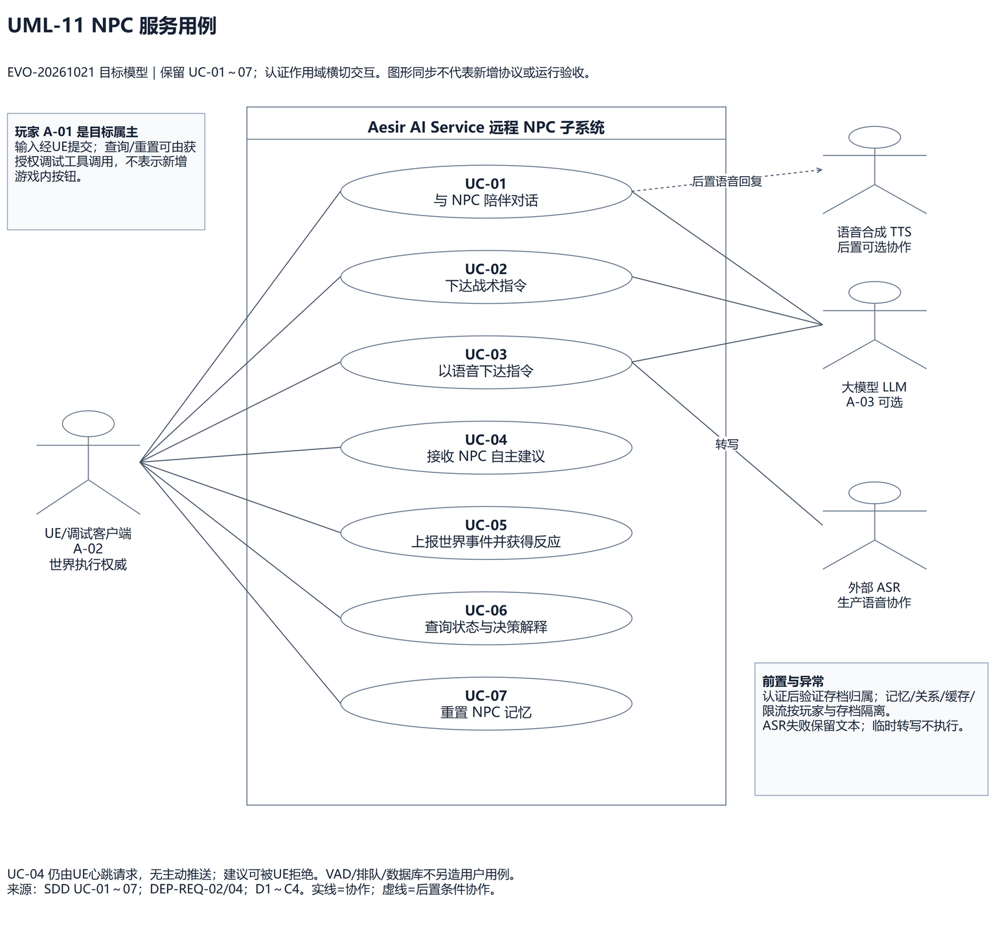
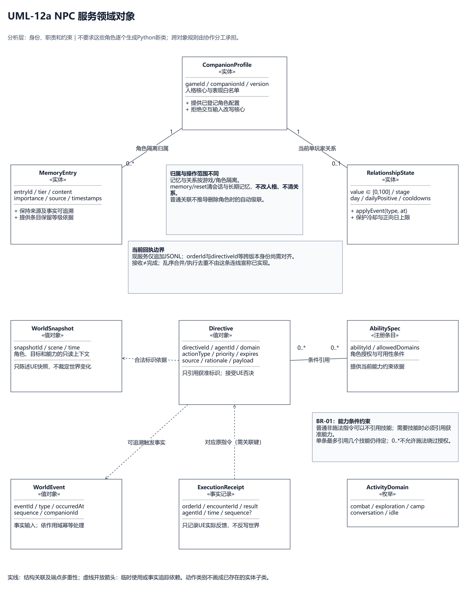
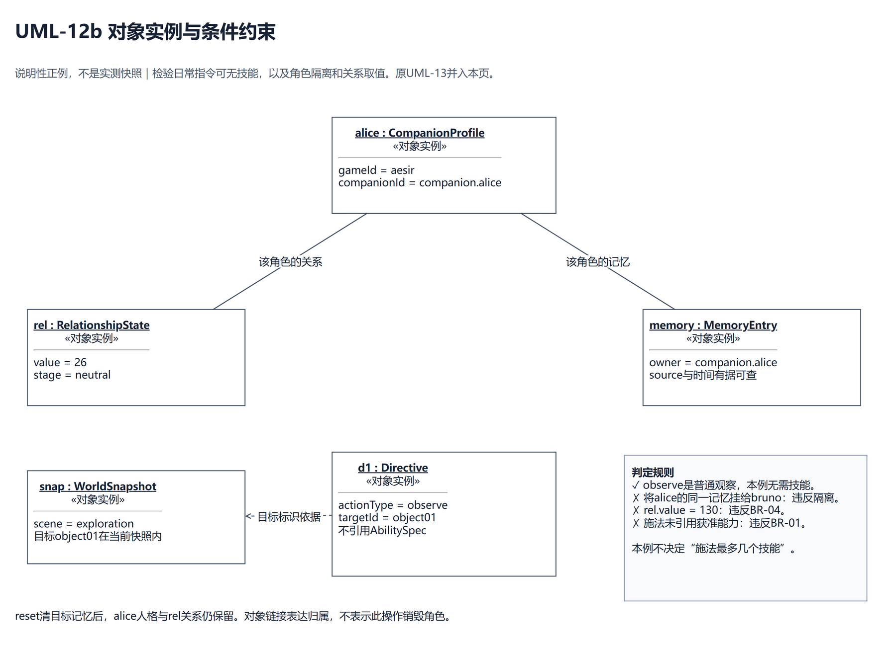
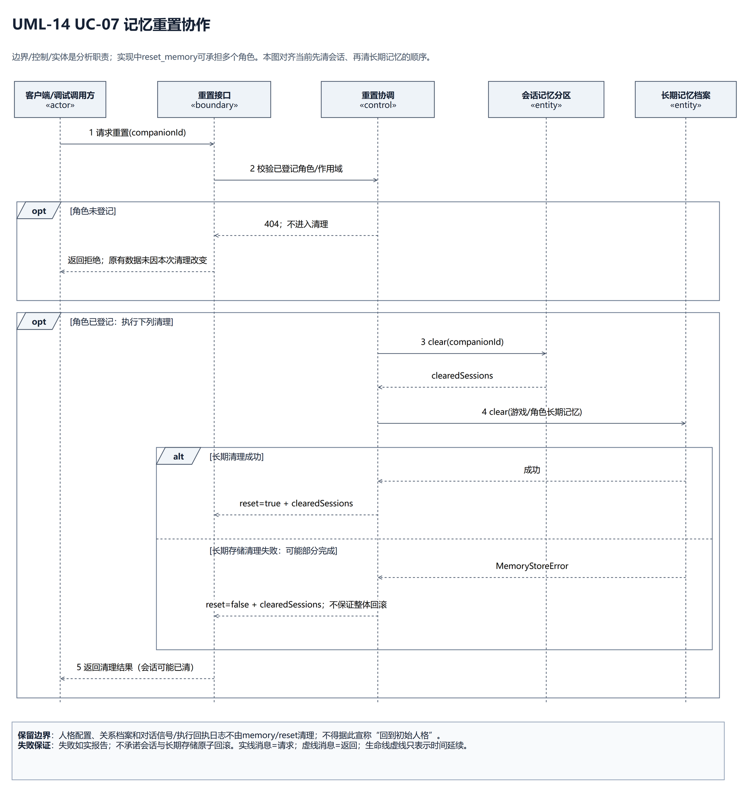
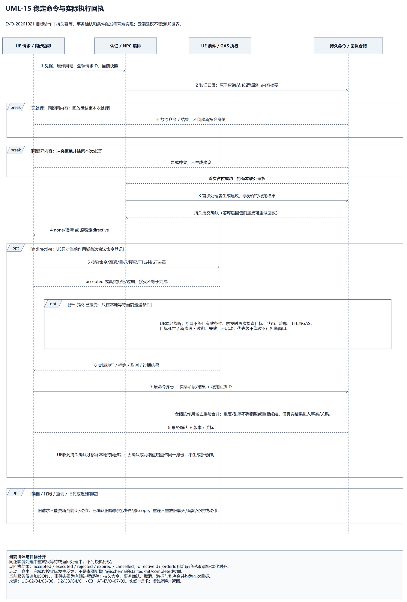

# Aesir Agent — 需求规格说明书 v1.1

> 项目：AesirWarden 的 NPC 人格与行为代理。系统边界：Python AI 服务，UE 在边界外。
> 初版日期：2026-09-25；本次整理：2026-10-19；输入代码基线：`a2dd4265a8211d7e221e0d72e2e82864f7af1141`。
> 状态：当前需求与分析工作稿，人工/同伴模型接受及本轮运行验收均未完成。文档修订不表示代码已实现新增目标。

本文件是当前服务需求主文：保留 8 REQ、7 UC、10 BR、5 NFR、12 AT，附原 45 FR、8 US 映射和 13 SC 目标。原 v1.0 的有效章程与总策划的范围、分工、演进边界已合并；旧稿和旧 UML 从 Git 基线回查，不再维护项目内备份。任务状态见 [todo](todo.md)，协议字段以 [v0.3 契约](../protocols/npc-contract-v0.3.md)及其引用的兼容契约为准，课程提交入口见 [课程索引](course-requirements-index.md)。

需求目标、配置默认值、历史测试、当前实现、人工接受分别记录。配置中存在一个数字，不代表所有成员已批准它为最终业务规则；服务测试通过、HTTP 202 或图能导出，也不代表 UE 执行或课程模型验收通过。

> 2026-10-21 部署目标补充：本文的本机回环、仅本地文件及 OUT-01/OUT-03、NFR-01 保留为原基线。用户已确认的“Boss 本地、队友语义/对话/长期状态云端”位置与玩家/存档隔离、数据库演进，按[六步方案](local-boss-cloud-companion-roadmap.md)和[15 项部署分工对照](ai-capability-placement.md)覆盖上述部署假设；UE 世界权威、工具只读和 Boss/NPC 分离继续有效。此补充不改原 FR/REQ/UC/SC 数字，不表示实现或验收完成；VAD/TTS、缓存协议和自动模型分发不得据此写成已实现。

## 阅读与权威范围

| 要确认的问题 | 维护位置 |
| --- | --- |
| 做什么、为什么、异常后是什么状态 | 本文件的 REQ/BR/NFR、UC 与对象分析 |
| 精确端点、字段、枚举、兼容与当前实现差距 | [NPC 契约 v0.3](../protocols/npc-contract-v0.3.md)、[战术契约 v0.2](../protocols/combat-tactical-protocol-v0.2.md)、[原接口 v0.1](../protocols/ue-protocol-contract-v0.1.md) |
| 人格包/游戏档案格式 | [persona-pack schema v0.2](../protocols/persona-pack-schema-v0.2.md)；数据格式版本与 API 版本分开 |
| 当前端口、能力对照、UE 联调步骤和采样 | [两端对齐](../protocols/integration-alignment-v0.3.md)、[启动指南](../guides/getting-started.md) |
| 真实历史记录和测试 | [验证记录](../logs/verification-records.md)、CHANGELOG、对应提交及真实原始输出；历史范围不能被本稿新结论倒写覆盖 |
| 游戏流程、Boss RL、整组 Word | UE 仓库现有 Docs；服务详细模型与整组视图的映射见课程索引 |

发生冲突时，代码/schema决定“此版本实际能做什么”；已确认需求决定“应该做什么”。两者不同登记差距，不能用实现默认值静默批准新需求，也不能用需求文字宣称实现已完成。

# 0 项目章程与范围背景

## 0.1 延续的七项原则

这些原则提取自原 v1.0，不新增数据库、审批平台或运维流程。与其相关的规则和验收仍需在下文按编号说明。

| 原编号 | 当前原则与理由 |
| --- | --- |
| I 配置外置 | 人格、能力目录、阈值、优先级、节流、关系规则与表现 ID 使用版本化 YAML/JSON。配置非法应给出可定位错误；调参不把台词/业务数值散入代码。实际配置版本随响应与记录可追溯。 |
| II 模型输出不可信 | 外部输入隔离；输出依次进行结构、上下文白名单、人设一致性检查。失败按受控路径重试/降级/拒绝；不得因为“模型说可以”绕过规则。严格结构检查是目标，当前不同入口的覆盖差距见第 5 部分。 |
| III UE 唯一权威 | UE 裁定血量、命中、位移、资源、冷却、目标和动画；Python 返回候选建议。快照可能过期，执行前由 UE 再校验，服务的只读工具不能改变世界。 |
| IV 测试先行 | 新行为实现前准备有意义的失败/正常/条件不满足/重复事件用例；契约和 golden 样例先于相关实现变更。默认测试隔离外部后端，缺依赖的跳过需明确范围。此原则不要求为本次可逆文档编辑新增镜像测试。 |
| V 可解释、可回退 | 原因、来源、版本和关联标识用于解释决策；任一依赖故障时给出明确降级/拒绝，客户端保留本地兜底，不阻塞游戏主流程。启动时非法配置可以快速失败，不能假装带坏配置正常工作。 |
| VI 单一指令寻址 | 统一指令信封，按动作类型分发；实现按域分文件，不再新建平行命令族。现有 v0.1/v0.2 兼容入口的存在不等于已经完成统一信封到旧 order 的全部映射。 |
| VII 简单优先 | 无明确必要性不引入 DB/MQ/向量库或投机抽象。先完成可演示、可解释、可验收的主线，扩展不成为当前闭环前置。 |

本机回环部署、本地文件持久化、凭据不入代码/日志/响应、外部输入隔离、人格表达不越玩家边界继续有效。真实 LLM/ASR 可选；离线规则模式可以工作不等于真实模型模式没有外发。原“仅保留摘要”与现有记录的差距在 NFR-05 和第 5 部分明列。

## 0.2 整组体验、责任与演进边界

玩家在 UE 的 ARPG 中与 Alice 协作：同一句请求应随战况、同伴状态与关系产生合法且可解释的结果。治疗/护盾等是体验示例，不表示 UE 已有这些技能；能下发什么以当场获准目录和实际能力为准。服务侧对话、记忆、关系、自主建议可分别验收，完整游戏闭环还需要 UE 校验、执行和真实反馈。

| 责任方 | 负责内容 | 不能代替的责任 |
| --- | --- | --- |
| dyh（Python NPC） | 服务 schema/路由、LLM/ASR接入、人格、记忆/关系、自主行为、策略与服务测试 | 不能证明 UE 已施法、命中、恢复或显示了结果 |
| yjx / YYchainsAw（UE 与 Boss RL） | UE 战斗、行为树/组件、HTTP、UI/动画，以及独立 Boss RL 训练与冻结推理 | 不把另一仓需求目标视为服务负责人已完成协议接受 |
| 共同 | 能力/事件/表现 ID、上下文与回执映射、golden 样例、试玩规则和联调判据 | 两端各自通过测试不等于端到端通过 |

沿用总策划的边界：一进程一游戏，按游戏/角色配置组织数据；L0 提供对话/记忆/关系，L3 启用完整世界/事件/战术链路，能力不足必须明确门控或降级。人格包引用须落在所属游戏声明中；格式细则只在 schema 维护。跨游戏复用属于已开展的架构演进，不把全部第三方接入或行为级门控自动加入当前课程交付。单独人格微服务、动态 Scene 枚举、单进程多游戏 profile、通用方言映射引擎均不作为本轮任务。

NPC 走位 RL、对话 RL 导演层等扩展仍须独立确认；Boss RL 是本仓独立模块与 UE 研究线，不并入以下 8 REQ。M1/M2 主线或当前单关的验收不以这些扩展成功为前置。旧策划的阶段勾选、工期估计和已经过期的下一步列表不再复制，任务统一在 todo/Issue 更新。

# 第一部分 需求基线（H0 工作稿）

## 1.1 范围表

| 编号 | 范围 | 来源 |
| --- | --- | --- |
| IN-01 | 陪伴对话与流式表达：人格、记忆注入、关系语气、表达校验 | 原任务转变与 v1.0 US1/US2；FR-001～018；BR-02/04/05/09/10 |
| IN-02 | 战斗文本指令解析和上下文决策，返回合法受限建议 | US4；FR-026～031；战术契约 v0.2 |
| IN-03 | 语音转写后复用相应文本入口；语音指令和语音闲聊分流 | FR-026；当前路由和 v0.3 契约入口表 |
| IN-04 | UE 心跳驱动自主建议：禁打断、候选、仲裁、校验、节流 | US3；FR-019～025；`/v1/agent/step` |
| IN-05 | 世界事件反应、关系联动与有限幂等回放 | US5；FR-032～034；`/v1/world/events` |
| IN-06 | 当前调试状态、记忆查询、指定角色记忆清理；决策解释目标 | US7/FR-010/031/042；UC-06/07 |
| IN-07 | 注册角色路由、游戏/角色作用域及状态隔离目标 | US8/FR-044；游戏档案与人格包格式；未覆盖入口的差距另列 |

内部责任包括记忆管理、关系计算、防刷、白名单、事件缓存和配置读取；不将算法、数据库或内部模块画成外部参与者。

## 1.2 非范围

| 编号 | 明确不做 | 依据 |
| --- | --- | --- |
| OUT-01 | 多用户、账号、联网对战、跨设备记忆同步 | 原单机本地假设 |
| OUT-02 | 自主演化或由玩家/模型改写人格核心 | FR-005/017；BR-10 |
| OUT-03 | 重型中间件、公网服务部署 | 原章程 I/VII；NFR-01 |
| OUT-04 | Python 直接裁定/改变 UE 世界状态 | FR-039；章程 III |
| OUT-05 | 未立项的对话 RL 导演层作为当前交付 | 原文只有扩展登记，没有批准证据 |
| OUT-06 | Boss RL 并入 NPC 服务主线 | 独立模块、接口与研究验收 |

## 1.3 参与者：目标与权限

| 编号 | 角色 | 目标与边界 |
| --- | --- | --- |
| A-01 玩家 | 终端目标属主，经 UE 间接操作 | 对话、记忆/关系体验、文本/语音协作；不能直接设定关系数值或改写核心人格。不是直接 HTTP 调用者。 |
| A-02 客户端调用方 | UE / 本机调试工具 | 游戏链路由 UE 上报快照/事件并权威执行或否决；本机调试工具可查状态和发起记忆清理。二者是本模型中的外部调用方角色，不因此取得新的权限系统，也不表示 UE 已做调试按钮。 |
| A-03 可选大模型服务 | 外部文本/信号生成协作方 | 输出不可信，必须验证；不可用时受控降级。ASR 若为本地库不单独画外部 actor，实际外部配置须说明数据流。 |

同一人可扮演不同角色，不能由此推导角色继承。服务局部用例图以直接交互方 A-02/A-03 连线；玩家 A-01 的目标属主关系在图注与本表说明，避免把间接使用误画为直连服务。

## 1.4 功能需求清单（REQ 稳定）

| 需求 ID | 目标 | 对应用例 | 原来源 |
| --- | --- | --- | --- |
| REQ-01 | 人格化对话、被记住、受关系影响且有据可查 | UC-01 | US1/US2/US6；FR-001～018/035～038 |
| REQ-02 | 文本战术指令获得随情境变化、可解释的合法建议 | UC-02 | US4；FR-026～031 |
| REQ-03 | 语音指令转写后进入相应文本链路 | UC-03 | US4；FR-026 |
| REQ-04 | 玩家无指令时基于快照产生不打扰的自主建议 | UC-04 | US3；FR-019～025 |
| REQ-05 | 上报世界事件，获得恰当、不重复的新反应 | UC-05 | US5；FR-032～034 |
| REQ-06 | 查看当前状态并解释关联的决策；历史/执行解释按可用记录说明 | UC-06 | US7；FR-031/042；SC-013 |
| REQ-07 | 清理指定 NPC 的会话和长期记忆，保留人格/关系及其他角色 | UC-07 | US1；FR-010；当前 reset 源码 |
| REQ-08 | 注册角色路由和游戏/角色状态隔离 | 横切 UC-01～07，重点 UC-01/02/04 | US8；FR-044；现有配置门控 |

## 1.5 业务规则（BR 稳定）

下表把业务约束与已有配置参数同时列明。来源分为历史明确决定、配置基线、需求目标；除明确记录外，不把所有数字标成“人工确认”。实现覆盖不完整的部分见第 5 部分。

| 编号 | 规则 | 来源/状态 |
| --- | --- | --- |
| BR-01 | 服务只读世界，指令仅引用本次上下文中的角色/目标/能力/行为类型。越界拒绝，不静默替换；未知动作类型降级为空动作。普通移动/社交/日常建议可以不引用技能；需要技能时必须引用获准能力。模型用 `0..*` 表达一般可选关联，**每条需要能力的建议引用数量尚未冻结**，不据此允许施法零技能。UE 保留最终校验与否决。 | FR-030/039/040；UE 2026-10-18 DEC-03“技能数量待定，先保留条件约束”；服务负责人协议接受仍待对齐 |
| BR-02 | 玩家输入隔离与转义；模型输出按结构→标识白名单→人设一致性验证。失败按重试一次→规则回退→安全候选→明确拒绝的适用路径降级，`source` 留痕。严格拒绝多余字段是规范目标，当前并非所有 schema 均已配置 `extra=forbid`。 | 原章程 II；`untrusted_input.py`；当前 schema 覆盖差距 |
| BR-03 | 同一作用域内重复 `event_id` 回放首次结果，不产生第二次新反应；状态边沿触发，不逐帧刷事件。现有缓存为有容量的进程内缓存，有淘汰/重启边界；不能据此承诺无限期 exactly-once。UE 对相同建议仍需执行去重。 | FR-033/034；`event_policy.py`；缓存范围见契约 |
| BR-04 | 关系值 0～100，初始 20；distant[0,24]/neutral[25,49]/friendly[50,74]/close[75,100]。事实事件与对话信号驱动，执行冷却和每日正向净变化上限；各阶段区分称呼、主动度、资源投入意愿、服从度；损坏回退初始值。配置基线为事实冷却60秒、对话300秒、日正向上限15、负向不限。 | 2026-09-22真实试玩及用户决定；`relationship_policy.yaml`。展示名为疏远/平常/友好/亲密，属当前配置 |
| BR-05 | 记忆分会话、经历摘要、长期档案与印象层，容量/预算/淘汰可配置；承诺和重大事件优先保留，推测不作事实，保留来源与时间。旧规格记录容量50/80/40、注入12、印象主题200、权重0.75、半衰期7天/显著28天；实际运行须记录加载配置，尤其会话窗口不把旧50条目标等同当前默认10轮。memory/reset只清指定角色会话及长期记忆，不修改人格/关系，不承诺跨存储原子回滚。 | FR-006～012；当前 Settings/记忆实现与 `console.reset_memory`；旧参数不自动成为已批准最终值 |
| BR-06 | 自主行为按当前目录选择：follow/move_to/observe/inspect/interact/pickup/rest/wait/express/self_talk/alert_player。原目标非战斗至少8类；目录11类不等于 UE 已能执行11类。禁打断为剧情/玩家讲话/NPC施法/弹窗；优先级为危险自保＞战斗战术＞玩家指令＞剧情事件＞关系事件＞日常自主。既有节流配置为同源300秒、不超过单窗口3次；校验快照目标、类型/距离、有效期，不可执行时返回空或说明。 | FR-019～025；`agency_policy.yaml`与行为目录；原目标及配置基线 |
| BR-07 | 查证只读，使用 lore/world.snapshot/world.interactables/self.status/memory.recall 五类现有工具；默认至多两轮（查证+正式回复）、总预算2秒、回填400字符。无结果明确不确定，不编造；超过预算降级。 | FR-035～038；工具注册表/Settings，具体值为当前配置依据 |
| BR-08 | 按当前游戏的 `companion_id` 注册表路由；未知/跨游戏角色拒绝，不回退默认角色。记忆、关系、能力与表现按作用域隔离。现有回执 `game_id` 由请求填入且入口未完整绑定运行游戏，是尚未关闭的实现差距，不能仅靠目录分区声称全面隔离。 | FR-044；游戏档案/注册表；回执入口差距 |
| BR-09 | 校验出戏术语、禁忌表达和无支撑事实，失败重试后用角色化安全候选；占有/控制/贬低/胁迫/情感勒索不得输出。 | FR-002/003；`style_policy.yaml`；原表达约束 |
| BR-10 | 核心人格不可被玩家或模型输出改写；关系变化不能越过玩家边界；玩家发言是不可信数据，不是修改人格的指令。 | FR-005/017；原章程 II/III |

## 1.6 非功能约束（NFR 稳定）

| 编号 | 目标、当前边界和验收 |
| --- | --- |
| NFR-01 | 本机单机、回环监听；默认 NPC 端口8011，按 `AESIR_SERVICE_PORT` 配置；Boss服务8012独立。凭据不入代码、文档、日志或响应。本地HTTP不代表外部模型没有外发。 |
| NFR-02 | 保留原目标：战斗指令端到端P95＜3s，自主判定P95＜1s、空动作＜100ms，纯规则P95＜100ms，查证总预算2s。SC-011已有独立细化：规则战术链路P95≤300ms、同一场遭遇≥30次文本/语音混样，LLM生成单报。100ms与300ms的适用路径/起止不能混用，需两端冻结口径；必须记录硬件、版本、后端、样本及失败，不以HTTP响应耗时证明NPC已开始表现。 |
| NFR-03 | 运行依赖故障时明确降级/拒绝且不阻塞游戏；非法启动配置应可定位地快速失败。LLM熔断阈值和恢复窗口为配置，旧默认5次/60秒不等于本轮实测，也不是Boss的3次BT回退规则。 |
| NFR-04 | 关联标识、来源、原因和策略版本用于观测；交互不自动用于训练。当前响应、信号和回执日志各有覆盖边界；日志缺失不编造历史，指标脚本PASS只能证明其实际检查的代理条件。 |
| NFR-05 | 原“不存原始音频、原始输入默认仅留摘要、不泄露凭据/内部细节”的隐私目标保留。当前正常对话会尝试记录完整玩家/回复文本，显著声明可能逐字入档；未传session_id仍可能写事实/印象/信号。需按契约说明实际数据流/本地保留/重置范围及可选外部LLM/ASR后端；保留时长和远端删除未确定时明确待确认，不伪称零外发或memory/reset清除了所有日志。 |

## 1.7 验收样例（AT 稳定，预期结果不代表通过）

| ID | 条件/操作 | 预期结果 | 依据 |
| --- | --- | --- | --- |
| AT-01 | 关系24再+2；99再+6 | 24→26进入neutral；99→100不越界 | BR-04 |
| AT-02 | 同类事实事件10秒内3次；当日正向累计15后再+6 | 冷却内不计新分；正向净变化不越配置上限 | BR-04 |
| AT-03 | 300秒内两轮warm；mock/回退对话 | 第二轮不计分；不支持信号的mock/回退不虚构关系增量 | BR-04 |
| AT-04 | 当前有效缓存作用域内同event_id上报两次 | 回放首次结果标重复，不生成新的反应；缓存淘汰/重启及UE执行去重另测 | BR-03 |
| AT-05 | 写入20条有据记忆，完整重启再询问 | 正确引用率100%；引用存在不等于引用正确 | BR-05；SC-001 |
| AT-06 | 同源300秒内再次满足；禁打断时满足 | 不产出新自主建议 | BR-06 |
| AT-07 | 指定不存在能力/目标；普通无技能日常建议；需技能但缺获准能力 | 越界拒绝、不擅自替换；日常无技能可合法；需技能不得绕授权。数量上限不在本轮擅自冻结 | BR-01；SC-009 |
| AT-08 | 有据设定/无据设定 | 前者与权威源一致，后者明确不确定，不编造 | BR-07；SC-008 |
| AT-09 | 未登记/跨游戏角色；B会话读取A记忆 | 拒绝且不落默认角色，状态不串角色；回执game_id入口差距须单独暴露，不能当全面通过 | BR-08；SC-012 |
| AT-10 | 按加载阈值连续故障触发熔断后再对话/查询 | 标出降级来源和原因；未知或缺失决策记录不伪造；不把降级次数作为完整解释覆盖率 | BR-02；NFR-03/04 |
| AT-11 | 记忆目录不可写/文件损坏后继续对话 | 说明降级；不阻塞游戏；允许已成功的独立写入保留，不宣称跨存储整体回滚 | BR-05；NFR-03 |
| AT-12 | 清角色A记忆；再注入长期存储故障重试 | 成功仅A会话/长期记忆清理，人格、关系及B不变；失败如实返回reset=false及实际会话清理数，不承诺原状态全部不变，信号/回执日志不因此删除 | REQ-07；BR-05/08 |

本轮未执行以上运行验收。REQ-06还需检查：查询当前状态与相关响应/日志可关联；不存在或未保留的指定历史明确说明；accepted/202不显示“完成”；只有真实UE证据才解释命中/完成。此为SC-013的补充检查，不能仅用AT-10熔断通过替代。旧SC目标全文见附录B。

## 1.8 来源、实际决定和待确认

| 来源 | 使用范围与版本 |
| --- | --- |
| 原v1.0及总策划v0.2 | 本轮Git输入`a2dd426`；有效章程/FR/US/SC/分工/演进边界已提取；原文件退出现行目录，历史路径见课程索引 |
| 2026-09-21～22真实会话复盘、CHANGELOG | 对话信号推动关系和节流校准的历史决定；不扩展成所有参数已签署 |
| 当前schema/路由/配置 | 当前实现事实；本轮未读.env或密钥，未启动服务/UE/外部后端 |
| UE COURSE-20261018-R1 | 整组游戏、NPC9FR/7UC、技能条件与真实回执目标；UE用户决定不自动代表服务负责人已签署扩展协议 |
| 本轮审查/授权 | 2026-10-19用户授权按审查方案整理Docs、重构draw.io；真实问题→修改记录见课程索引；不补造旧提示或验收签名 |

需求负责人/审阅职责沿用 dyh（Python）与 yjx（UE）；本稿模型接受未签署。仍待确认：

1. 每条需技能指令的能力数量、`directive_id`到`order_id`映射和真实阶段/终态/乱序规则；现有accepted/executed等不自动支持started/hit/completed。
2. 当前D盘UE工程真实对话、技能执行、事件/回执闭环与故障反馈；旧工程源码关系、E盘临时heartbeat日志、HTTP成功均不能替代。
3. 性能目标的分路径起止、配置/硬件/样本，尤其原100ms目标与SC-011 300ms硬指标的适用边界。
4. 实际LLM/ASR后端、上下文/音频发送范围、日志和远端保留/删除范围。没有决定的时长不由AI补数字。
5. 结构严格拒绝、回执游戏门控、执行去重与状态机等实现差距是否/何时修复；本次只修文档，未关闭这些问题。

v0.3已经独立成文，关系中文展示名已有配置，两者不再列作“尚未发布/尚无命名”。对话RL导演层仍是未批准扩展。

# 第二部分 用例模型

## 2.1 用例图与建模决定

[UML-11图源](../design/uml/src/11-npc-service-use-cases.drawio)

图覆盖UC-01～07，玩家目标通过A-02进入服务；LLM仅可选协作。已提供快照是前置/输入，不为每个心跳机械include“上报快照”；语音转写、查证是相应用例步骤，不因技术动作另造用户目标。UC-01与UC-02独立：聊天不自动施法，指令不自动闲聊。UC-06/07的本机调试能力不自动成为游戏内新增按钮。

## 2.2 UC-01 与NPC陪伴对话

| 项目 | 规格 |
| --- | --- |
| 参与者/触发 | A-01经A-02提交文本；A-03可选。文字/流式闲聊或语音闲聊按当前契约分流，不把语音战术解析当闲聊。 |
| 前置/目标 | 已登记角色的人格可加载；产出有据、人格一致的回复。入口仍验证未知角色。 |
| 基本流 | ①校验请求并路由角色；②读取可用记忆/关系、构造上下文；③规则或模型生成并执行结构/白名单/表达校验；④按实际记录时机尝试会话、长期记忆、信号及关系更新；⑤返回回复与实际可用来源/原因/版本/关系增量，流式按其协议阶段返回。 |
| 步骤异常 | 1a未知/跨游戏角色拒绝，不回默认；2a读存储失败：用可用上下文降级；3a模型/校验失败：按BR-02/09重试、回退或明确拒绝；4a独立存储故障：保留已成功的更新；可观测降级是目标，当前记忆/关系标记未全面覆盖，不声称整体回滚；4b关系信号冷却：不计分；5a流式已返回内容后记录失败：如实保留可获得错误/降级记录，不伪称撤回已发内容。 |
| 成功/失败保证 | 成功得到合法回复，更新只按有效信号/配置发生；失败不编造记忆/增量、不越角色。记忆与关系等分开提交，失败可能部分完成，当前降级标记覆盖不足仍列差距。 |
| 依据 | REQ-01；BR-02/04/05/08/09/10；AT-03/05/10/11；UML-12 |

## 2.3 UC-02 下达战术指令

| 项目 | 规格 |
| --- | --- |
| 参与者/触发 | A-01经A-02提交文本与当前战斗上下文，A-03可选；入口为tactical/command或有text的agent/step。 |
| 前置/目标 | 当前角色、快照和能力目录合法；产出可解释的候选建议。 |
| 基本流 | ①验证身份与上下文；②解析意图；③结合快照/关系/状态决策，验证目标及条件能力；④返回有标识、有效期、原因/来源/版本的受限建议；⑤UE再校验并决定拒绝/执行；实际结果可经现有回执入口报告。步骤⑤为跨端协作，不是服务接口成功的必要实测结论。 |
| 步骤异常 | 1a未知/跨域拒绝；2a含糊澄清不猜执行；3a未授权、目标无效/资源不足等拒绝或解释，不替换指定技能；3b模型不可用走规则；4a迟到/过期/旧遭遇响应由UE拒绝影响；5aUE忙碌、冷却、激活/执行失败据实反馈；5b重复/乱序回执不应制造第二次执行，现服务仅追加记录，不假称已实现状态合并。 |
| 成功/失败保证 | 服务成功仅证明产出合法建议；UE接受、启动、命中和完成分别据实。失败不下发越界建议；回执202仅表示受理记录，不保证执行或日志状态机。 |
| 依据 | REQ-02/08；BR-01/02/08；AT-07/09；UML-12/15；阶段与数量未决见1.8 |

## 2.4 UC-03 以语音下达指令

| 项目 | 规格 |
| --- | --- |
| 参与者/触发 | A-01经A-02上传指令音频；格式/上限按当前契约。闲聊音频走独立语音对话入口。 |
| 前置/目标 | 选定ASR可用或mock；有效语音进入与文本同义的后续校验。 |
| 基本流 | ①按当前入口检查请求并选择后端；②转写；③以转写文本进入相应文本链；④按入口返回：voice/command仅返回ParseCommandResponse，不带转写文本；speech/transcribe返回text/language；companion/chat/voice附transcribed_text及对话结果。不把收到音频当命令有效，v0.1组合解析不因此拥有完整世界上下文执行链。 |
| 步骤异常 | 1a格式/大小/时长违规应拒绝是目标，当前没有统一的大小/时长/WAV头强校验，不写成已完成门禁；2a真实ASR无有效转写时应明确说明，不造命令。mock可按配置对空音频返回文本，不能用mock证明语音质量校验有效；2bASR不可用：明确失败/降级，保留文本入口；3a文本含糊或越界按相应文本链约束处理。 |
| 成功/失败保证 | 结果遵守对应文本约束；不留存原始音频为隐私目标，实际后端/日志范围须核对。解析成功不证明UE执行。 |
| 依据 | REQ-03；FR-026；BR-01/02；NFR-03/05；AT-07；UML-11/15 |

## 2.5 UC-04 接收NPC自主行为

| 项目 | 规格 |
| --- | --- |
| 参与者/触发 | UE以心跳请求agent/step；无主动服务推送。玩家是目标属主。 |
| 前置/目标 | 有合法场景快照；时间/区域缺失时不启用对应行为。 |
| 基本流 | ①校验快照/角色；②判定场景和禁打断；③候选生成、优先级仲裁；④校验目标/距离/类型/条件能力与有效期；⑤节流后返回至多一条受限建议或无动作；⑥UE再校验，若执行再报告真实反馈。 |
| 步骤异常 | 1a未知/跨域拒绝；2a禁打断返回空；3a战斗域排除生活候选；4a不可执行/过期候选为空并说明；5a同源冷却中不生成新建议；6aUE拒绝/迟到/重复处理按UC-02边界。 |
| 成功/失败保证 | 合法无动作是正常结果，不虚构动作；服务返回建议不等于NPC已经行动。 |
| 依据 | REQ-04/08；BR-01/06/08；AT-06/07/09；UML-11/12/15 |

## 2.6 UC-05 上报世界事件并获得反应

| 项目 | 规格 |
| --- | --- |
| 参与者/触发 | A-02上报所属游戏已声明的状态边沿事件。 |
| 前置/目标 | 正常事件含类型、event_id、时间和序号；入口仍检查非法输入。 |
| 基本流 | ①验证作用域/事件；②检查当前缓存幂等键；③生成台词/表现/建议/可选动作，按规则联动关系；④返回结果和可用关联/来源；⑤UE校验实际动作并在需要时报告反馈。 |
| 步骤异常 | 1a未知类型/非法时间422，未声明/未授权按门控拒绝；2a有效缓存重复回放首次结果，不新计分/生成反应；3a能力不可用动作置空仍可返回合法台词；3b存储/关系失败不伪称已更新；5a同建议在UE去重，不用缓存回放替代执行保护。 |
| 成功/失败保证 | 在有效缓存作用域内事件重放不造成新的服务业务贡献；缓存淘汰/重启后无无限期保证，实际动作执行由UE防重复。 |
| 依据 | REQ-05；BR-03/04/08；AT-02/04/09；UML-11/12/15 |

## 2.7 UC-06 查询状态与决策解释

| 项目 | 规格 |
| --- | --- |
| 参与者/触发 | A-02本机调试入口查询console/state、memory或检查关联响应/日志；不新增游戏内UI要求。 |
| 前置/目标 | 角色已登记；当前状态可查，目标是解释指定决策可用的输入→理解→关系→决策→依据→结果链路。 |
| 基本流 | ①验证角色和查询范围；②读取当前状态/记忆摘要/版本；③按已有响应、请求标识和保留日志定位所查决策；④返回可获得的事实与缺失范围。当前console主要提供当前状态，不假称已经存在任意request_id历史检索API。 |
| 步骤异常 | 1a未知角色拒绝；2a子系统降级应明确标识为目标，当前记忆/关系标记覆盖仍有缺口；3a记录不存在/未保留/无执行回执：明确“无记录/未知”，不能用当前状态冒充过去快照；4a只收到accepted/202：只能说明受理，不能展示完成。 |
| 成功/失败保证 | 查询不修改世界/人格；解释只引用有据记录，不泄露凭据或捏造执行。SC-013完整覆盖仍为验收目标，受现有埋点/历史查询/跨端回执缺口限制。 |
| 依据 | REQ-06；FR-031/042/043；NFR-04；AT-10与1.7补充判据；UML-11/12/15 |

## 2.8 UC-07 重置NPC记忆

| 项目 | 规格 |
| --- | --- |
| 参与者/触发 | A-02本机客户端发POST /v1/console/memory/reset，指定companion_id。 |
| 前置/目标 | 正常角色已登记；清其会话和长期记忆，让后续交互不再使用旧记忆；不重建人格/关系。 |
| 基本流 | ①校验并路由当前游戏角色；②清该角色会话分区并得到实际清理数；③尝试清该角色长期记忆（摘要/档案/印象及存储管理的条目）；④汇总reset和cleared_sessions并返回。 |
| 步骤异常 | 1a未登记/跨游戏角色：404，不开始清理；2a无会话：清理数0仍可继续；3a长期存储故障：reset=false，会话可能已清，不承诺回滚或所有长期文件原样；4a报告失败/部分完成，允许调用方核查后重试，不谎报全部成功。 |
| 成功/失败保证 | 成功清指定角色记忆，保留人格与关系/其他角色；信号、回执及其他独立日志不由该接口删除。失败如实报告，保持作用域隔离；不保证失败前状态全部不变。并发对话/清理不承诺未设计的事务隔离。 |
| 依据 | REQ-07；FR-010；BR-05/08/10；AT-12；UML-12/14；console.reset_memory当前顺序 |

# 第三部分 对象职责与局部协作

## 3.1 候选筛选

以下为分析概念，不要求新增同名Python类。当前统一Envelope/类型联合不等于五种有独立身份的实体；关系和职责也不由代码类名数量决定。

| 候选 | 处理与职责依据 |
| --- | --- |
| CompanionProfile | 保留角色身份/人格配置概念；按游戏和companion_id选择，核心设定受保护；REQ-01/08、BR-08/10 |
| MemoryEntry / MemoryArchive | 保留有来源/时间的记忆条目与分层档案职责；配置/会话/档案区别清楚；REQ-01/07、BR-05 |
| SessionMemory | 局部保留角色会话分区的管理职责；跨会话持久记忆不能因省略session_id就称全部无状态 |
| RelationshipState | 保留关系状态和事件驱动规则；清记忆不清关系；REQ-01/02/05、BR-04 |
| WorldSnapshot / WorldEvent | 保留只读值/事件输入，快照不是权威世界；事件键用于有限缓存，不能代替执行去重；BR-01/03 |
| Directive | 保留统一建议值，携带上下文关联、类型/目标、优先级/有效期和理由；类型按战斗/移动/交互/社交/日常分类，不为本轮建立平行协议 |
| AbilitySpec | 保留获准能力目录项；一般指令可零引用，需能力时必须授权，数量未冻结；BR-01 |
| ExecutionReceipt | 保留客户端报告的事实值；关联order_id/encounter_id/request_id，directive_id映射仍待对齐；当前服务追加记录，不自动维护完整执行实体状态机 |
| ActivityDomain | 枚举/分类值，不造独立有身份实体 |
| MemoryResetCoordinator / 重置接口 | 局部control/boundary职责，可映射现有reset_memory函数/HTTP路由；协调不吞并人格/关系/记忆的业务约束 |
| DialogueService、Arbiter、Throttle、StyleGuard | 应用/控制职责，移出领域概念图不是删除其实现，也不表示控制版型不得存在 |
| System、Database、“配置” | 不作装饰性领域实体；具体持久化与外部边界按协作用例解释 |

## 3.2 核心CRC与不变量

每项职责可独立解释；不要求用getter/setter凑方法。内聚的数据/规则可由一个实现对象承担，协调者不能随意改写全部实体状态。

| 对象 | 两项业务职责 | 协作者 | 不变量（及依据） |
| --- | --- | --- | --- |
| CompanionProfile | 维护游戏/角色身份及人格版本；提供受保护的禁忌/表现配置并拒绝越权改写 | MemoryArchive、RelationshipState、角色注册表 | 当前请求只关联已登记且属于当前游戏的角色；memory/reset不改变人格（BR-08/10） |
| MemoryEntry / MemoryArchive | 维护内容的来源/时间及层级；按预算和保留优先级检索/清理指定角色记录 | CompanionProfile、SessionMemory | 不将推测存为事实，不读取/清除其他角色条目；具体容量随加载配置（BR-05/08） |
| SessionMemory | 维护指定角色的会话分区；清理匹配分区并报告实际数量 | CompanionProfile、重置协调 | 仅清指定角色分区；cleared_sessions不冒充长期清理成功（BR-05/08） |
| RelationshipState | 依据有效事件/信号更新；保护阶段、冷却和正向日上限 | CompanionProfile、WorldEvent、对话信号 | 关系值保持0～100，阶段与值一致，清记忆不将关系重置（BR-04） |
| Directive | 表达当前快照内的受限建议；携带合法性所需标识、有效期/理由供UE复核 | WorldSnapshot、AbilitySpec、ExecutionReceipt | 不引用上下文外目标/能力，需技能时必须获准；数量未冻结（BR-01） |
| WorldEvent | 表达有来源的状态边沿事实；提供作用域内幂等关联键 | RelationshipState、事件处理控制 | 同一有效缓存键回放不产生新服务反应，缓存外保证不夸大（BR-03） |
| ExecutionReceipt | 表达客户端实际报告的结果和原因；关联原order/请求/遭遇供检查 | Directive、客户端、追加存储 | 不把accepted/HTTP202或缺记录推断为完成；不声称日志追加就是去重/终态合并（NFR-04） |

## 3.3 分析类图与关系理由

[UML-12两页图源](../design/uml/src/12-npc-service-domain.drawio)

| 关系 | 双向读法、理由与反例 |
| --- | --- |
| CompanionProfile—MemoryEntry | 当前角色可有0..*记忆；每条记忆归属于一个游戏/角色。用普通关联说明归属，不用“清记忆”推导人格生命周期。反例：A和B共享同一可变记忆条目而造成串读/串清，违反BR-08。 |
| CompanionProfile—RelationshipState | 本地单玩家范围中，一个角色至多0..1当前关系状态；关系只归该角色/当前玩家作用域。尚未建立/损坏恢复是边界例，不强制启动时永远已有1条。反例：memory/reset重建人格/关系，违背该操作范围。 |
| Directive—AbilitySpec | 一般指令0..*能力引用，每个能力可被多条建议引用；条件是需技能的建议必须引用获准能力、数量未冻结。合法反例是无技能observe；非法反例是cast引用不存在能力。普通关联的数量不替代条件谓词。 |
| Directive ⇢ WorldSnapshot / WorldEvent | 指令依赖只读快照提供合法标识依据，依赖事件提供可追溯触发事实。每次心跳至多1条建议或无动作，事件可返回反应与可选动作；依赖不代表指令拥有或改变输入。 |
| ExecutionReceipt ⇢ Directive | 事实追踪依赖表达“反馈必须能找到原建议/旧order”，不是普通结构拥有关系；当前以order_id/encounter_id/request_id为主，directive_id映射/乱序语义待对齐。没有回执是合法缺信息，不能画成每个指令必已有完成回执。 |

组合如有真实整体/部分生命周期可使用，但本模型不靠清记忆操作推断关系销毁。活动类型是分类；同一Envelope如何在代码判别，继续以schema为准。

## 3.4 对象正例与反例

UML-12b将旧UML-13并入同源附页：Alice在exploration快照下产生observe建议，**零技能引用可以合法**，关系值26/neutral仅为样例。它不是运行快照，也不证明UE已执行。反例：关系值130；同一可变记忆被两个角色共享；施法引用未授权能力；accepted被显示为已完成。分别违反BR-04、BR-08、BR-01及NFR-04/回执边界。

## 3.5 UC-07局部BCE分工

这是为了独立解释服务局部设计补充的样例，不是每个仓库或每个UC都必须做一套。整组已选G-UC-06重试作为深入对象分析与BCE，可通过课程索引复用；此处的类/方法名称是逻辑职责，不新增实现要求。

| 版型/逻辑职责 | 负责 | 不承担/当前映射 |
| --- | --- | --- |
| boundary 重置接口 | 接收请求、将结果如实返回调用方 | 不自行清人格/关系；映射console HTTP路由 |
| control MemoryResetCoordinator（重置协调） | 先确认角色范围，协调先会话后长期清理，汇总结果 | 不承诺事务或覆盖实体全部规则；现reset_memory函数可兼任 |
| entity CompanionProfile/角色注册表 | 提供真实身份与当前游戏归属 | 不能为未知角色落默认；get_registered_profile |
| entity SessionMemory | 维护/清理指定角色会话分区，报告实际清理数 | 不清其他角色；get_session_memory().clear |
| entity MemoryArchive | 清理指定角色分层记忆，向协调者报告完成/存储故障 | 不以成功清会话代替长期成功；get_memory_store(...).clear |
| entity RelationshipState | 保护关系状态及更新规则 | 本用例没有清关系消息；人格、关系和独立日志均保留 |

SessionMemory/MemoryArchive在实现中也涉及技术存储；这里的entity标签只说明它们承担数据归属和状态约束，文件I/O细节可以位于存储适配边界，不要求为课程重写代码层次。

[UML-14图源](../design/uml/src/14-memory-reset-sequence.drawio)

成功消息：①调用方→重置接口→协调：请求指定角色；②协调→注册表：确认身份/范围；③协调→SessionMemory：清角色会话并收取数量；④协调→MemoryArchive：清角色长期记忆并收到完成；⑤协调→接口→调用方：reset=true和实际cleared_sessions。没有清人格、清关系或清独立日志消息。

失败/边界消息：未知角色在②拒绝，尚不清理；无会话时③报告0仍可继续；④失败向协调报告MemoryStoreError，协调返回reset=false及已获得的会话数量。会话可能已清，不补造回滚；不能根据未完成的长期清理推断所有文件完全不变。操作作用域必须始终保持指定游戏/角色，重试不能隐式扩大到所有角色。

## 3.6 指令协作与当前回执边界

[UML-15图源](../design/uml/src/15-directive-execution-sequence.drawio)

建议产生、UE受理、本地激活/开始、命中、完成是不同事实。当前回执枚举是`accepted/executed/rejected/expired/cancelled`，协议字段和状态含义见权威契约；不新增started/hit/completed字段并宣称现已支持。HTTP202仅确认接收记录，当前存储只是JSONL追加，未校验同一指令的去重、阶段转换或乱序终态合并。

需要的目标约束是：UE拒绝过期/旧遭遇/非法动作；实际反馈可关联原建议；重复/乱序不得制造新的实际动作或虚假终态。这些约束需协议与实现另行对齐。只写`directive_id`、`order_id`或sequence字段不等于映射/状态机已经完成。LLM失败回退与合法无动作可继续交互，不能把它们都当UE执行失败。

# 第四部分 追踪与验收边界

## 4.1 REQ—用例—职责—规则—验收

| REQ | UC与图 | 对象/规则 | 检查入口（本轮未执行） |
| --- | --- | --- | --- |
| REQ-01 | UC-01；11/12 | Profile、Memory、Relationship；BR-02/04/05/07/09/10 | AT-01/02/03/05/08/10/11；SC-001/003/008 |
| REQ-02 | UC-02；11/12/15 | Directive、Ability、Snapshot、Receipt；BR-01/02 | AT-07/10；SC-002/009/011；跨端执行另验 |
| REQ-03 | UC-03；11/15 | 文本链复用；NFR-03/05 | AT-07；SC-009/010/011；有效/空/噪声/ASR失败及文本回退 |
| REQ-04 | UC-04；11/12/15 | 快照、候选、优先级、节流；BR-01/06 | AT-06/07；SC-005/006；目录覆盖不能替代游戏中复现 |
| REQ-05 | UC-05；11/12/15 | Event、Relationship、Directive；BR-03/04/08 | AT-02/04/09；SC-004/007；缓存边界与UE执行去重分测 |
| REQ-06 | UC-06；11/12/15 | 当前状态、关联响应/日志、Receipt；NFR-04 | AT-10只验降级；SC-013及1.7查询/缺记录/真实阶段补充判据才验证解释范围 |
| REQ-07 | UC-07；11/12/14 | Profile、SessionMemory、MemoryArchive、Relationship保留；BR-05/08/10 | AT-12正常/部分失败/其他角色不变；不以会话清理代替全成功 |
| REQ-08 | 横切UC01～07；11/12/15 | 角色/游戏/能力/事件作用域；BR-08 | AT-09/12；SC-012；回执门控差距不可跳过 |

## 4.2 原US/FR/SC映射

优先级沿用原需求故事，不作为本轮完成状态；原T001～T088属于历史任务编号，不继续在需求文档勾选，历史条目通过Git回查。FR逐条正文见附录A，SC全文见附录B。

| 原US | 用户价值/优先级 | FR | 当前REQ/UC | 原SC |
| --- | --- | --- | --- | --- |
| US1 | 记得玩家与共同经历，P1 | 006～012；人格支撑001～005 | REQ-01/07，UC-01/07 | 001/010 |
| US2 | 关系变化并影响行为，P1 | 013～018 | REQ-01/02/05，UC-01/02/05 | 003/004 |
| US3 | 非战斗自主生活，P1 | 019～025 | REQ-04，UC-04 | 005/006 |
| US4 | 自然语言战斗协作，P1 | 026～031 | REQ-02/03，UC-02/03 | 002/009/011 |
| US5 | 事件反应且不重复，P2 | 032～034 | REQ-05，UC-05 | 004/007 |
| US6 | 回答设定有据可查，P2 | 035～038 | REQ-01内UC-01查证步骤；BR-07 | 008 |
| US7 | 解释为什么，P2 | 031/042/043 | REQ-06，UC-06及各响应 | 013 |
| US8 | 增角色且状态隔离，P3 | 044 | REQ-08，横切UC | 012 |
| 横切约束 | 安全、边界和统一寻址 | 039～043/045 | 全部REQ/UC；BR-01/02/08、NFR | 009/010/013 |

## 4.3 判断结果的边界

单元/接口测试只证明对应版本和输入；HTTP样例只证明该路径；真实LLM对话只证明采样后端和轮次；UE实际动作、性能、隔离和研究评估必须各有证据。`metrics_report`的引用率>0、出现多个角色/关系阶段、记录降级次数只是覆盖代理，不能直接替代SC-001记忆正确率、SC-003人工区分率、SC-010不中断游戏或SC-012隔离。

没有latency样本/未区分路径/未记录UE输入到开始表现时，不判SC-011通过；没有完整历史链路与真实结果，不判SC-013通过。保留以前日期明确的测试记录，但本轮没有重跑服务、UE、真人ASR、LLM、性能或研究实验，不更新运行通过结论。

# 第五部分 当前差距与真实修订

## 5.1 尚未关闭的实现/协议差距

| ID | 当前事实与目标差距 | 文档处理/关闭所需 |
| --- | --- | --- |
| SVC-GAP-01 | 各schema对额外字段/标识格式覆盖不一，回执并非统一strict/UUID | 按端点写实际约束；若提高严格性，另评估兼容并修改代码测试 |
| SVC-GAP-02 | 回执game_id由请求提供，未完全绑定当前游戏；目录分区不是入口授权 | 明列门控缺口；实现和跨游戏负例验证后再关闭 |
| SVC-GAP-03 | 进程内有限事件缓存不保证重启/淘汰后幂等；UE执行去重需独立成立 | 契约列作用域；服务回放、游戏执行和回执追加分别检查 |
| SVC-GAP-04 | 回执仅追加；阶段/乱序/终态合并和directive→order映射尚未完整对齐 | 不写成已实施执行状态机；按双方确认协议另行实现 |
| SVC-GAP-05 | 数据实际记录/外发比旧“仅摘要/完全无状态”更广；reset不清信号/回执日志 | 契约/指南列数据流，保留/删除未决；不以本稿承诺已完成擦除 |
| SVC-GAP-06 | 当前状态查询与已有日志不足以保证任意历史决策完整解释；指标代理不足 | 缺记录返回未知；补真实追踪/人工判据后才能验收SC-013 |
| SVC-GAP-07 | 当前D盘UE对话/执行/反馈闭环与正式SC011未由本轮验证 | 区分旧工程、E盘临时心跳日志与当前D盘工程，保存配置/协议/游戏实际记录 |

这些差距没有因文档更正而解决。本机默认8011与当前UE默认8011已经对齐，是新代码基线事实；旧8000/8001导出证据仍按当时版本理解。

## 5.2 本轮修订与历史来源

| 记录 | 实际问题/处理 | 状态 |
| --- | --- | --- |
| 历史CH-01～08 | 课程结构、对话信号、印象层、11类目录、编号映射及白名单/输入隔离/有效期补记 | 由原v1.1保留的真实历史，不作为本轮新运行证据 |
| 历史2026-10-08拆图 | 三图拆独立源并导出；对象依据纠错；原CH表出现两条CH-10编号碰撞 | 原记录见Git，本稿按日期/主题说明，不补造新历史编号；渲染不等于人工接受 |
| 2026-10-19需求整合 | 抽取v1.0章程/45FR/8US/13SC、GDD边界，旧稿退出当前维护；目标与代码事实分开 | 当前修订稿 |
| 2026-10-19模型纠正 | 能力条件/数量未冻结；reset保留人格关系/部分失败；对话不保证整体回滚；解释/回执/隐私差距登记 | AI修订与自查，待人工/同伴接受 |
| 2026-10-19课程模型 | 重构11/12，旧13并入12b，补14重置与15指令协作；原图按Git回查，无项目备份 | 图源/导出与检查状态见UML索引和课程索引；非运行通过 |

真实人工问题、来源版本和修订状态集中在课程索引。没有旧完整提示、冻结签名或同伴接受记录的部分明确保留缺口，不用本稿回填“已批准”。

# 附录A 原FR-001～045正文

逐条保留原v1.0文字以维持编号/来源。下列是需求正文，不是已经实现或通过的清单；与经记录修订冲突时，按本稿BR/UC的明确说明理解。FR-014的驱动来源已由2026-09-22决定扩为“事实事件＋对话情感信号”（BR-04）；FR-007补印象层（BR-05）；FR-025/030/040不强迫日常行为必选技能，但所有指令的角色、目标、行为类型等标识仍须合法，需技能时能力也须获准；FR-010不清人格/关系/独立日志，不承诺整体回滚。

- **FR-001**: 系统 MUST 以单一配置源定义每个 NPC 的人格（身份、背景、价值观、好恶、说话风格、禁忌表达、语气示例），且人格文案不得散落在代码逻辑中。

- **FR-002**: 系统 MUST 保证 NPC 的表达在其人格设定范围内，且**禁止**出现游戏机制、系统、协议等破坏沉浸感的术语。

- **FR-003**: 系统 MUST 对所有 NPC 输出执行内容校验，拒绝符合禁忌表达清单的内容；校验失败时 MUST 重试并以角色化表达兜底。

- **FR-004**: 系统 MUST 支持NPC 的持续情绪状态与当前关注点，使其跨多次交互保持情绪连贯（而非每次重置）。

- **FR-005**: NPC 人格中的核心设定 MUST 不可被模型输出或玩家输入改写。

- **FR-006**: 系统 MUST 持久化 NPC 的记忆，使其在重启后仍然有效。

- **FR-007**: 系统 MUST 分级管理记忆：当前会话内的短期上下文、跨会话的经历摘要、长期关系与事实档案，并明确各自的容量与淘汰规则。

- **FR-008**: 系统 MUST 在记忆达到容量上限时按重要性与时间淘汰，且承诺类与重大事件类记忆 MUST 优先保留。

- **FR-009**: 系统 MUST 在生成回应时按可控预算使用记忆，避免上下文无限增长。

- **FR-010**: 系统 MUST 提供清空指定 NPC 记忆的能力。

- **FR-011**: 记忆不可用时，系统 MUST 继续提供服务并降级为无长期记忆的行为，且 MUST NOT 因此中断玩家流程。

- **FR-012**: 系统 MUST NOT 将推测内容作为事实写入长期记忆，且记忆条目 MUST 可追溯来源与发生时间。

- **FR-013**: 系统 MUST 为每个 NPC 维护对玩家的长期关系状态，并持久化。

- **FR-014**: 关系变化 MUST 由游戏内发生的**事实事件**驱动，且事件类型与影响幅度 MUST 可配置。

- **FR-015**: 系统 MUST 对同类事件的重复触发实施限制，防止通过重复行为快速刷高关系。

- **FR-016**: 关系状态 MUST 划分阶段，且每个阶段 MUST 定义可观察的差异，至少覆盖：称呼与语气、主动互动频率、资源投入意愿、对危险指令的服从度。

- **FR-017**: 关系 MUST NOT 导致违反安全与合规约束的行为，也 MUST NOT 使 NPC 越过玩家边界或出现控制性表达。

- **FR-018**: 关系状态异常时，系统 MUST 以初始状态继续运行。

- **FR-019**: 系统 MUST 区分 NPC 所处的活动场景（战斗、探索、营地休整、对话、待机），并在不同场景下提供不同的可执行行为集合。

- **FR-020**: 系统 MUST 支持 NPC 在非战斗场景中的自主行为，且自主行为类型 MUST 覆盖不少于 8 类（含跟随、移动、观察、查看、交互、拾取、休整、等待、表达、自言自语等）。

- **FR-021**: 系统 MUST 在无玩家指令时，基于客户端上报的世界状态与世界时间判断是否发起自主行为；系统 MUST NOT 主动向客户端推送。

- **FR-022**: 系统 MUST 对自主行为实施节流与去重，保证同一触发源在短期内不重复触发，并限制单位时间内的触发次数。

- **FR-023**: 系统 MUST 支持禁止打断的情形（剧情演出、玩家正在说话、NPC 正在施法、界面弹窗），在这些情形下 MUST 不发起自主行为。

- **FR-024**: 系统 MUST 按统一优先级仲裁多个候选行为，优先级从高到低 MUST 至少覆盖：危险自保、战斗战术、玩家指令、剧情事件、关系事件、日常自主行为。

- **FR-025**: 系统 MUST NOT 输出无法执行的行为；当目标、条件或资源不满足时，MUST 返回明确的不可执行说明而非虚构行为。

- **FR-026**: 系统 MUST 支持玩家以文本与语音两种方式下达指令，语音在转写后 MUST 进入与文本一致的后续处理。

- **FR-027**: 系统 MUST 将玩家自然语言解析为受白名单约束的语义意图，且解析 MUST 在规则与模型两种方式间可切换并在失败时自动降级。

- **FR-028**: 系统 MUST 在解析无法确定意图时请求澄清，MUST NOT 猜测执行。

- **FR-029**: 系统 MUST 结合当前世界状态、NPC 自身状态与关系阶段决定最终行为，并保证同一意图在不同情境下可产生不同结果。

- **FR-030**: 系统 MUST NOT 使用当前不可用的能力，也 MUST NOT 以目录外的能力替代玩家的指定目标。

- **FR-031**: 系统 MUST 为每次决策产出可解释的原因说明。

- **FR-032**: 系统 MUST 处理客户端上报的世界事件（含战斗与生活两类），并返回 NPC 的反应与可选建议。

- **FR-033**: 系统 MUST 对事件处理实施幂等，同一事件标识重复上报时 MUST 回放首次结果且不产生新行为。

- **FR-034**: 系统 MUST 仅依据世界状态边沿变化触发反应，MUST NOT 依赖逐帧上报。

- **FR-035**: 系统 MUST 以统一注册表描述 NPC 的全部可用能力，涵盖战斗行为、生活行为与信息查询三类。

- **FR-036**: 系统 MUST 允许为回答设定类与状态类问题而查证权威信息源，且查证 MUST 为只读。

- **FR-037**: 查证失败或无结果时，系统 MUST 明确表示不确定，MUST NOT 编造事实。

- **FR-038**: 查证 MUST 有轮次与时间上限，超限后 MUST 降级为直接回应。

- **FR-039**: 系统 MUST NOT 直接改变游戏世界状态；一切改变 MUST 以受约束的指令形式交由客户端执行，客户端 MUST 保有最终否决权。

- **FR-040**: 系统下发的指令 MUST 只引用本次交互上下文中已存在的标识，越界 MUST 被拒绝。

- **FR-041**: 系统 MUST 在任一子系统（模型、语音、记忆、关系、查证、配置）故障时保持可用并降级，MUST NOT 阻塞客户端的游戏主流程。

- **FR-042**: 系统 MUST 记录每次交互的来源与版本信息，用于观测与归因，且 MUST NOT 将交互数据自动用于训练。

- **FR-043**: 系统 MUST NOT 在输出中泄露内部实现细节（路径、资产名、坐标、函数名、凭据）。

- **FR-044**: 系统 MUST 支持面向多个 NPC 的路由与状态隔离，且未登记角色 MUST 被拒绝而不回退至默认角色。

- **FR-045**: 系统 MUST 采用**单一指令体系**：所有下发指令使用同一信封并按行为类型区分；实现层按活动场景分文件组织，MUST NOT 建立平行的多套指令体系。

# 附录B 原SC-001～013目标

保留原目标、编号及量化文字；**不将这些目标、历史脚本PASS或本次文档自查写成已通过**。游戏可观察行为与服务目录、自动代理与人工判断需分开。SC-011原“即时”已在[联调采样口径](../protocols/integration-alignment-v0.3.md#性能采样与正式验收)细化为规则战术链路P95≤300ms、≥30次同场文本/语音混合采样；LLM生成单报，开始表现不能用收到HTTP响应替代。SC-013缺完整历史/实际执行时只能明确未覆盖，不编造解释。

- **SC-001**: 玩家在会话中提及的个人信息与共同经历，在服务重启后再次对话时能被正确引用，正确率 **100%**（抽样不少于 20 条记忆）。

- **SC-002**: 同一句战术指令在不少于 4 类不同战况下产生不同且合理的结果，人工判定合理率 **≥ 90%**。

- **SC-003**: 关系状态在不少于 3 个阶段下，同一指令的语气与行为表现可被人工区分，区分成立率 **≥ 90%**。

- **SC-004**: 在单位时间窗口内重复触发同类关系事件，关系数值变化为 **0**（防刷有效）。

- **SC-005**: 非战斗场景中 NPC 可观察到的自主行为类型 **≥ 8 类**，且每类至少可稳定复现一次。

- **SC-006**: 自主行为的重复触发率（同一触发源在窗口内重复）为 **0**；打断关键演出的次数为 **0**。

- **SC-007**: 同一事件重复上报时，重复响应率（产生第二次实际行为）为 **0**。

- **SC-008**: 设定类问题的回答与权威信息源一致率 **100%**；无据可查时明确表示不确定的比例 **100%**（不允许编造）。

- **SC-009**: 指令中引用的能力或目标超出当前可用范围的越界下发次数为 **0**。

- **SC-010**: 任一子系统故障时，玩家可继续正常游戏且能得到可理解的反馈，流程中断次数 **0**。

- **SC-011**: 战斗场景下从玩家发出指令到 NPC 开始响应的等待时间，玩家可感知为"即时"，人工评估达标率 **≥ 95%**。

- **SC-012**: 新增第二个角色时，系统结构无需变更即可正确路由并隔离状态，验收通过率 **100%**。

- **SC-013**: 演示时，评审可对任意一次 NPC 决策获得"输入—理解—关系状态—决策—依据—结果"的完整解释，覆盖率 **100%**。
